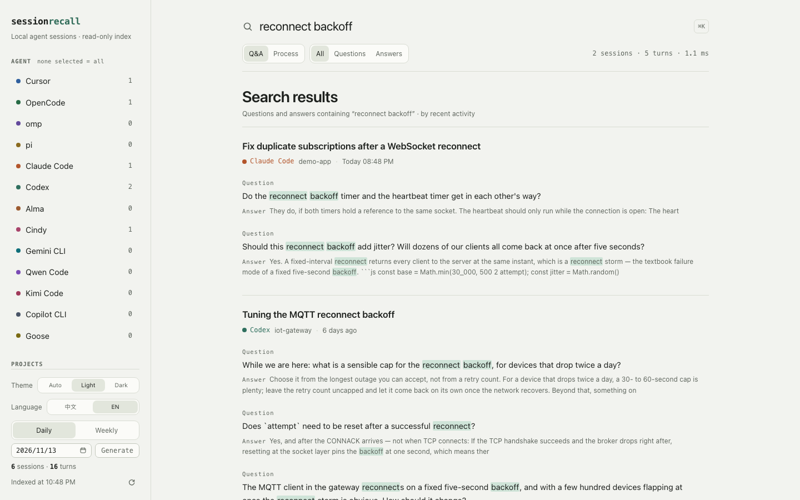
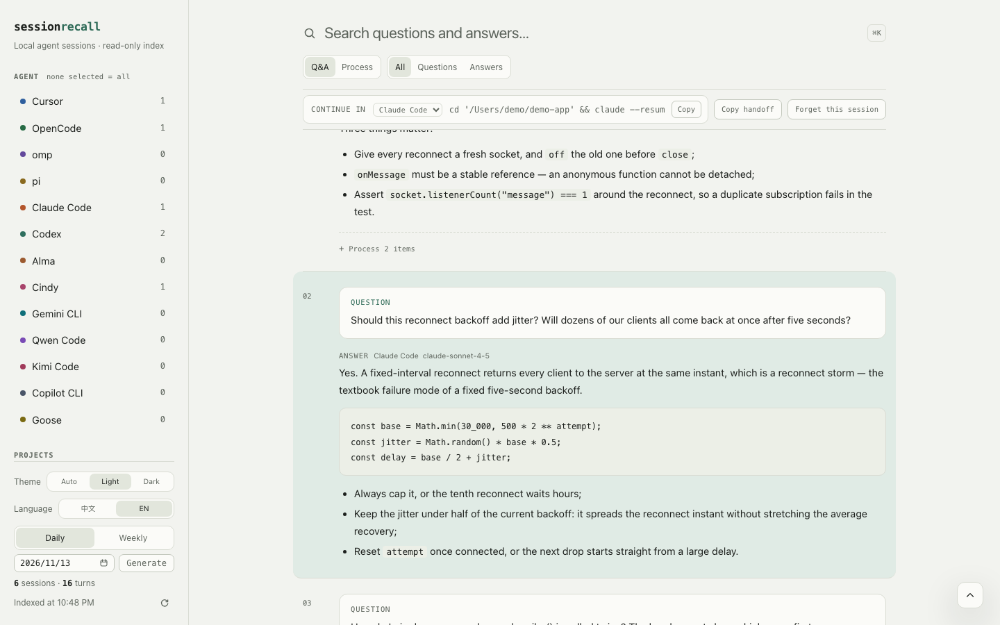
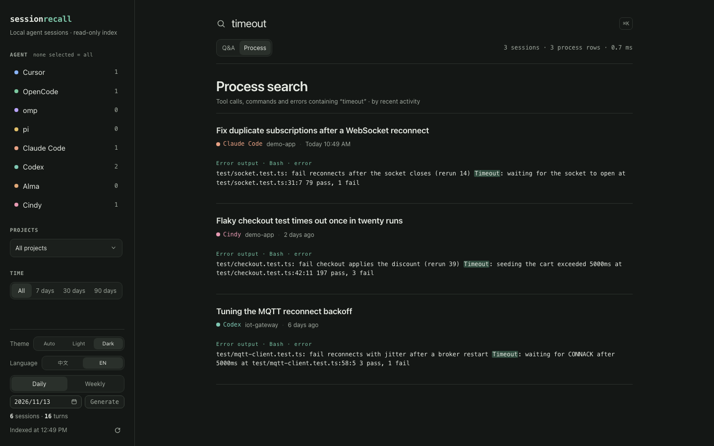

# session recall

[English](README.md) | [Chinese](README.zh-CN.md)

[](LICENSE)
[](https://github.com/odinyu/session-recall/actions/workflows/ci.yml)

A local, read-only full-text index over the coding-agent sessions on this Mac.
Search a half-remembered Chinese phrase or a code identifier and get back the
question, the answer, the agent, the project, and the date.

Built for the sessions that pile up across **omp**, **pi**, **OpenCode**,
**Cursor**, **Alma**, **Cindy**, **Claude Code**, **Codex**, **Gemini CLI**,
**Qwen Code**, **Kimi Code**, **Copilot CLI**, and **Goose**. It never writes to
an agent's own storage.

## Quick start

Requires macOS and Bun 1.3+.

```bash
git clone https://github.com/odinyu/session-recall.git
cd session-recall
bun run scan      # build the index (first run: a few seconds)
bun run sr "websocket" --limit 3   # search from the shell (see Search)
bun run start     # build the UI and serve http://127.0.0.1:4319
```

`bun run start` also scans on boot and refreshes the index every 90 seconds.
The rail footer switches the theme between Auto (follows macOS), Light, and
Dark, and the UI language between Chinese and English. Both choices are stored by
the server in `<app dir>/prefs.json` (see `src/prefs.ts`) rather than in
`localStorage`, so they survive the app restarting on a different port;
`localStorage` is only a same-origin cache for the first paint. API:
`GET /api/prefs`, and `PATCH /api/prefs` with `{"theme": …}` or
`{"language": …}` for `auto`, `light`/`dark` or `auto`/`zh`/`en`; anything
else is rejected with a 400.

## Packaged app

Build a double-clickable macOS `.app`:

```bash
bash scripts/make-app.sh
```

It builds the web UI, compiles the Bun CLI into a self-contained sidecar binary
(~63 MB, named for the host target triple), and lets Tauri bundle both:

```text
src-tauri/target/release/bundle/macos/Session Recall.app
```

The bundle is ad-hoc signed (`signingIdentity: "-"`); if you download or copy it
around, clear the quarantine flag first:

```bash
xattr -dr com.apple.quarantine "Session Recall.app"
```

**How it finds its parts.** Tauri ships the Bun CLI as an `externalBin` sidecar
at `Contents/MacOS/session-recall`, and the built web UI as a bundle resource at
`Contents/Resources/web/dist`. On launch the Rust shell
(`src-tauri/src/main.rs`):

1. reserves a free loopback port,
2. locates the sidecar — `$SESSION_RECALL_SIDECAR`, then any `session-recall*`
   file next to the main executable, then `src-tauri/binaries/` (for
   `cargo tauri dev`),
3. spawns it with `SESSION_RECALL_PORT` set to the reserved port and
   `SESSION_RECALL_WEB_DIST` pointing at the resource dir,
4. waits until the port accepts connections, then opens a `WKWebView` window on
   `http://127.0.0.1:<port>`,
5. answers `sessionrecall://` deep links (see below) by driving the UI's hash
   router, bringing the window forward if it was in the background,
6. kills the sidecar on quit, so no orphaned process is left behind.

The UI is served by Bun exactly as in `bun run serve`, so the app and the CLI
share one index at `~/Library/Application Support/session-recall/index.db` — and
so the window is purely a view over the same HTTP API. Web assets are shipped as
a bundle resource rather than embedded in the binary, so `bun run scan` still
works on a fresh clone that has no `web/dist`.

The icon lives at `src-tauri/app-icon.png`; regenerate the PNG with
`python3 scripts/make-icon.py` and the whole icon set with `cargo tauri icon`
from `src-tauri/`.

**How links find the app.** The reserved port changes on every launch, so no
`http://127.0.0.1:<port>` URL can address the app for longer than one run. The
bundle therefore registers its own URL scheme (`sessionrecall`, declared in
`tauri.conf.json` under `plugins.deep-link`, which is what puts the
`CFBundleURLTypes` entry in `Info.plist`). A link such as
`sessionrecall://session/alma%3Amwbhgpzz9n7zy56fdm` opens the app if it is not
running, focuses it if it is, and — in every case — lands on that session. A
link that arrives before the webview has finished loading is queued and applied
on the first finished page load, so a cold start cannot drop it.

`bash scripts/make-app.sh` builds for the host architecture only (arm64 on
Apple silicon, ~67 MB). `--arch aarch64-apple-darwin` / `--arch
x86_64-apple-darwin` build one specific slice, cross-compiling the sidecar if
needed; `--universal` builds one bundle covering both arm64 and x86_64 (~140 MB,
roughly double the size because it carries two Bun runtimes).

## Screenshots

Every screenshot below is rendered from a handful of invented sessions seeded
into a throwaway index by `scripts/capture-screenshots.sh`; the real index is
never read and never photographed.



A query across every indexed agent: the rail filters by agent, project and time,
and each hit shows the question, the answer, and where the terms matched.



One session, opened through a `?turn=` deep link that jumps to a single turn in
the dark theme: the addressed question is highlighted, its answer follows, and
the continue-in strip carries the exact resume command.



Process search looks past the prose into tool calls, commands and error output,
which is how a failing run behind a conversation gets found.


## What gets indexed

| Agent | Source | Extract |
|---|---|---|
| omp | `~/.omp/agent/sessions/<cwd>/*.jsonl` (plus profile roots) | user/assistant text messages; titles |
| pi | `~/Library/Application Support/CindyGlobal/pi-agent-home/sessions/*.jsonl`, `.../pi-package-home/sessions/*.jsonl`, and `~/.pi/agent/sessions/*.jsonl` | official pi shares omp's JSONL format: turns, thinking and tool calls become text + process events |
| OpenCode | `~/.local/share/opencode/opencode.db` | `session_v2` + `session_message` (falls back to the v1 `session`/`message`/`part` tables) |
| Cursor | `~/.cursor/projects/*/agent-transcripts/**/*.jsonl` and `state.vscdb` (`composerData` + `bubbleId`) | transcripts first, KV for chats without a transcript; project path from `workspaceIdentifier` |
| Alma | `~/Library/Application Support/alma/chat_threads.db` | `chat_threads` + `chat_messages` (message JSON `parts`); project path from `workspaces.path`; threads marked `is_incognito` are never listed |
| Cindy | `~/Library/Application Support/CindyGlobal/cindy-*.db` (newest match wins) | `sessions` + `messages`: user rows are JSON `{text}` or an Orca task `{orcaSource, content}`, assistant rows plain text, `thinking`/`tool_use`/`ask_user` rows become process events; project path from `working_dir`; `rewind_at` and messages before `cleared_at` are excluded |
| Claude Code | `~/.claude/projects/<project-slug>/<sessionId>.jsonl` | `user`/`assistant` records with Anthropic content blocks: text, `thinking` and `tool_use` become turns + process events, `tool_result` user records attach to their call; title from `ai-title`; project path from `cwd`; `isSidechain` subagent records are skipped |
| Codex | `~/.codex/sessions/YYYY/MM/DD/rollout-*.jsonl`, plus Cindy's `CindyGlobal/codex-home/sessions` and `.../archived_sessions` | `session_meta` + `turn_context` for cwd/model; `response_item` messages, `function_call`/`*_output` and `reasoning` become turns + process events; `event_msg` message echoes are ignored unless a rollout has no `response_item` messages |
| Gemini CLI | `~/.gemini/tmp/<project>/chats/session-*.jsonl` (`$GEMINI_DATA_DIR` overrides the root; older builds write the same conversation as one `.json` document) | `user` messages start turns, `gemini` messages supply the text, `model`, `thoughts` and `toolCalls` (name, `args`, `result`, `status`) become turns + process events; `info`/`error` notices and `$patch`/`$set`/`$rewindTo` edit records are skipped; title is the first prompt; project path from the `.project_root` marker (`projects.json` registry as fallback); subagent chats under `chats/<parentSessionId>/` are skipped |
| Qwen Code | `~/.qwen/projects/<project>/chats/<sessionId>.jsonl` (`$QWEN_DATA_DIR` overrides the root) | Gemini-CLI lineage records with `type` `user`/`assistant`/`tool_result`/`system`: `message.parts` text, `thought` parts and `functionCall` calls become turns + process events, `functionResponse` fills the matching call's output; title from a `custom_title` system record; project path from each record's `cwd`; user records with `system`/`external_agent` provenance or `agent_*` subtypes are skipped |
| Kimi Code | `~/.kimi/sessions/<workdir-digest>/<sessionId>/wire.jsonl`, plus `~/.kimi-code` (`$KIMI_DATA_DIR` overrides both) | wire envelopes `{timestamp, message: {type, payload}}`: `TurnBegin`/`SteerInput` prompts, `ContentPart` text and `think` chunks, `ToolCall`/`ToolResult` pairs become turns + process events; control and UI events (`Step*`, `TurnEnd`, `StatusUpdate`, `Notification`, `Approval*`, `Question*`) are skipped; title from `state.json` `custom_title`; project path by matching the md5 digest of `kimi.json` `work_dirs`; subagent transcripts under `agents/*/wire.jsonl` are skipped |
| Copilot CLI | `~/.copilot/session-state/<session-id>/events.jsonl` (`$COPILOT_HOME` overrides the root; pre-1.0.11 flat `<session-id>.jsonl`, plus `history-session-state`) | `user.message` starts a turn, `assistant.message` supplies text, `model` and `toolRequests`, `tool.execution_complete` fills the call output; `session.*`, `assistant.turn_*`/`assistant.reasoning`, `hook.*`, `subagent.*` and encrypted payloads are skipped; title from `workspace.yaml` `name`; project path from `session.start` `cwd` or `workspace.yaml` |
| Goose | `~/Library/Application Support/goose/sessions/sessions.db` (`$GOOSE_PATH_ROOT/data/sessions/sessions.db`, Linux `~/.local/share/goose/sessions` or `~/.local/share/Block/goose/sessions`, opened readonly) | `sessions` + `messages`: `content_json` text and `thinking` blocks become turns + process events, `toolRequest`/`toolResponse` blocks pair by id; rows with `metadata_json.userVisible: false` are skipped; title from `sessions.name` then `description`; project path from `working_dir`; columns are probed with `PRAGMA table_info` |

The index unit is a **turn**: one user prompt plus the assistant text that
followed it before the next prompt. Tool calls and reasoning traces are stored
separately as process events (see below); their inputs, outputs, and errors are
searchable in the **Process** scope, while reasoning text stays out of search.
Each turn also stores the model that produced its answer when the agent
records one. omp, pi, OpenCode, Alma, Cindy, Claude Code, Codex, Gemini CLI,
Qwen Code and Copilot CLI record it per turn; Gemini CLI and Qwen Code take the
model stamped on each assistant message, and Copilot CLI the one on each
`assistant.message` (its `session.model_change` value is the fallback). Cursor
and Goose record only a session-level selection (`composerData.modelConfig.modelName`
and `model_config_json.model_name`), which is stamped on every turn of that
session — Cursor transcripts and KV bubbles carry no per-turn model, and
Cursor's placeholder `default` stays blank. Kimi Code records no model. The
session page shows the model next to the agent badge.

## Process

When a turn has tool calls or reasoning, its transcript row shows a `Process`
disclosure. Opening it lazily loads that turn's events; each reasoning block and
tool call is its own collapsed row, and tool inputs/outputs are displayed as
plain text.

- Events live in the `event` table keyed by `(session_id, turn_idx, seq)`.
- Limits keep the index bounded: 30 events per turn, 1,200 per session;
  reasoning is capped at 2,000 characters, tool input at 1,000, and tool output
  at 2,000. Long values keep a head and a tail and are marked truncated.
- omp and pi attach `toolResult` messages to their `toolCall` by id; OpenCode reads
  the tool state's `input`/`output`; Cursor transcripts expose tool calls but
  usually not their results.
- Alma reads each `tool-<Name>` part directly: `input` is serialized as JSON and
  `output` (an object such as `{stdout, stderr, exitCode}`) is serialized as
  JSON. A call that had not produced output yet, that errored, or that the user
  denied keeps an empty output — nothing is invented — and the state shows up as
  the row's status (`ok`, `error`, `denied`, `input-available`, `input-streaming`).
- API: `GET /api/session/:id/events?turn=N` returns `{ turn, events }`.
- Search uses the same `scope` parameter as the UI: `scope=process` searches
  tool inputs, outputs, and extracted error text. It groups hits by session and
  reports `processTotal` plus each hit's `tool`, `turnIdx`, `status`, and
  `matchField` (`input`, `output`, or `error`). A result link carries the event
  sequence (`event=<seq>`), so opening it expands the turn's process, opens the
  matching event row, and scrolls that row under the sticky action bar. Reasoning
  is deliberately excluded from search. The process index is `event_search` (FTS5 `trigram` + `porter`,
  with a `LIKE` fallback for queries under three characters); it is rebuilt
  automatically when an older index is opened.

## Handoff card

Every session page has a `Copy handoff` button in the same sticky action bar. It copies a Markdown card meant to
be pasted into another agent or a scratchpad: project, agent, time range, resume
command (or Alma deep link), the last few prompts, the last answer (truncated
verbatim), files touched by tool calls, commands run, tool errors, and the
current Git branch/status when the project is a Git worktree. The card is
generated on demand from the local index; nothing is sent anywhere.

- API: `GET /api/session/:id/handoff` returns the Markdown (`text/markdown`);
  add `?targetAgent=<id>` for a cross-agent card.
- The UI prefetches the card when a session opens, so the copy button can write
  to the clipboard synchronously from the click (async work before
  `navigator.clipboard` loses the browser's user activation).

## Resume and cross-agent handoff

Every session page has a `Continue in` selector in the sticky action bar. It lists
every supported agent and shows how to continue *this* session there:

| Target | What the bar shows |
| --- | --- |
| Same agent | The exact resume command, or the app deep link where one exists |
| Another agent | A new-session command in that agent, with the handoff card as context |

```bash
cd '/path/to/project' && omp --resume <session-uuid>
cd '/path/to/project' && opencode --session <session-id>
cd '/path/to/project' && claude --resume <session-id>
cd '/path/to/project' && pi --session <session-uuid>
cd '/path/to/project' && codex resume <session-uuid>
cd '/path/to/project' && omp            # cross-agent: new session
cursor '/path/to/project'               # cross-agent: open the project
```

The path is shell-quoted; the omp/pi uuid is the suffix after the timestamp in
the stored session filename, and for Codex it is the trailing uuid of the rollout
file (Codex's `resume` syntax is version-dependent and unverified on this
machine). Alma's equivalent is the deep link that opens the thread in the Alma app:

```text
alma://thread/<thread-id>
```

Cross-agent handoff cannot transfer a session id: session ids only mean
something to their own agent. The bar therefore launches a **new** session in
the target agent and the copied handoff card becomes its context. Alma and Cindy
have no shell entry point, so their entries show a plain instruction (“start a new
session and paste the handoff card”) instead of a broken command.

`GET /api/session/<id>/handoff?targetAgent=<id>` (and the UI button) renders
the card for the selected target, adding a `## Continue in <Agent>` section with
that agent's command or instruction (the generator currently emits this heading
in Chinese). The session API returns the full
`continuations` list, so the UI never guesses another agent's CLI.

The app addresses its own pages the same way, with the `sessionrecall://` scheme
it registers at install time:

```text
sessionrecall://session/<session-id with : percent-encoded>
```

That is the link a daily brief emits and the link the iOS-style "open in app"
gesture resolves to. It is also accepted inside the app, where it is routed
directly rather than round-tripping through the OS.

Two query parameters carry context into the session page:

```text
sessionrecall://session/<id>?turn=3&q=websocket
```

- `turn` opens the session at that turn index and centres it in the viewport; a
  non-numeric or out-of-range value (or a stale index) opens the top instead.
- `q` is the search that produced the link. The app highlights those terms in
  the prompt, the answer and its code blocks, shows a “From the search … · View
  search results” strip above the action bar, and points “Back to search” at
  those results — so a
  cold start from a link does not land in a blank search page. Without `q` the
  link behaves exactly as before.

## Reports (daily and weekly)

Daily reports are short **standups** by default; the old full dump is still one
flag away.

```bash
bun run brief                              # today, standup
bun run brief 2026-11-11                   # a specific day, standup
bun run brief 2026-11-11 --format archive  # legacy full dump
bun run brief --week 2026-W46              # weekly rollup
bun run brief --help                       # flags
```

The app's sidebar footer carries the same two reports: pick a day in the
calendar, choose **Daily** or **Weekly**, then press **Generate**. The report opens in
the content pane (a weekly one links to `#/brief/2026-W46?format=week`) and is
also offered as a `.md` download.

Files live under `<app dir>/brief/` — `~/Library/Application Support/session-recall/brief/`
by default, next to the index, so this works from inside the packaged `.app`
too. Override with `SESSION_RECALL_BRIEF_DIR=/some/dir`.

```text
brief/
  daily/2026-11-11.md     # standup
  weekly/2026-W46.md      # weekly
  2026-11-11.md          # archive, the legacy path
  index.md                # newest daily + weekly entries
```

- **standup** (default): YAML front-matter (`kind`, `date`, `projects`,
  `sessions`, `turns`, `agents`, `generated_at`), a one-line summary, then
  `Progress / Decisions / Open threads / First task tomorrow / Overview`. Raw
  prompts stay out of this view.
- **archive**: exactly the previous dump — per-project prompts, tool/reasoning
  counts, resume command and deep link — still written to the legacy
  `<date>.md` path.
- **week**: front-matter with `kind: weekly`, `week`, `range`, `active_days`,
  then `Highlights / By project / Themes and decisions / Metrics / Risks / Next week`.
  It aggregates
  **from the DB by date range**, not by concatenating daily files, so days
  without a generated brief still count.

Reports skip hidden sessions: hiding a session drops it from daily, weekly and
archive output and from their counts, while a handoff card still opens it by id
when you ask for it.

Report templates exist in Chinese and English. The app writes the report in
its interface language (`auto` follows the browser); the CLI's `--lang zh|en`
overrides the stored preference; and the front matter records the choice as
`lang:`. When nothing else decides it, the report is Chinese.

Derivation is deterministic — no model calls:

- **Decisions** only from explicit `<!-- decision: … -->` markers in assistant text.
- **Open threads** from each session's last assistant message: unchecked
  `- [ ]` items plus lines that, after stripping a list prefix, **start with**
  `TODO` or with the localized to-do / next-step markers the generator
  recognizes (the exact marker list lives in `src/brief.ts`) — a passing mention
  mid-sentence is ignored. Code fences,
  table rows and schema-like text (`description:`, `{`, `|`, backticks) are
  dropped so noise does not become a task.
- **Risks** from the same last answers, with the same guard: the cleaned line
  must start with the localized risk / blocked / unresolved markers (or the
  English equivalents), so a passing mention of a risk inside a sentence is not
  counted as a blocker; weekly completion / in-progress markers classify
  sessions in the last answer.
- A session spanning several days is counted **once**, on its last active day;
  `active_days` counts days with at least one session.
- `brief/index.md` lists recent daily and weekly files, newest first.

The rail's `Generate` button creates the standup view for the chosen date; the
download keeps the YAML front-matter.

API: `POST /api/brief?date=YYYY-MM-DD&format=standup|archive|week` (default
`standup`; weekly also takes `week=YYYY-Www`) generates the file and returns its
Markdown; `GET /api/brief/file?format=…&date=…` (or `&week=…`) downloads it.
Invalid dates, weeks and formats are rejected with a 400.

## Search

- Two scopes, chosen beside the search box:
  - **Q&A** searches prompts and answers.
  - **Process** searches tool inputs (`path`, `command`, …), tool outputs, and
    extracted error lines.
- SQLite FTS5, over both scopes:
  - `trigram` for Chinese phrases and substring/code-identifier matching.
  - `porter` stemming as an English fallback.
- A query shorter than three characters (for example a two-character Chinese
  word) falls back to indexed `LIKE` with the same filters.
- Filters: agent, project, date range, and role (prompt / answer / both); the
  role filter is hidden in the process scope.
- Results group by session and sort by the session's last activity (newest
  first); within a session, matching turns sort newest first, with FTS rank as
  the final tie-break. A process hit links directly to its turn and opens the
  process disclosure; an answer hit scrolls to the answer rather than the start
  of the turn.
- The first screen loads 200 matching rows. If that covers only part of the
  sessions, the list footer offers `Show more` instead of telling you to narrow
  the filters; the UI can raise the limit up to 5,000 rows.
- Query syntax: bare terms, or `"an exact phrase"`; multi-term queries are ANDed.
- API: `GET /api/search?q=…&scope=qa|process&agent=…&project=…&from=…&to=…&role=…`;
  results carry `totalSessions`, `totalTurns`/`processTotal`, grouped sessions,
  and either `hits` or `processHits`.

From a shell or an agent with shell access (no server required):

```bash
bun run sr "directory scope" --limit 5
bun run sr "websocket" --agent omp --json
bun run sr "ENOENT" --scope process
```

- `--limit <n>` caps the returned sessions (1–5000, default 10); `--agent` is
  repeatable or comma-separated; `--scope qa|process` picks question/answer
  pairs or tool calls and errors.
- `--json` prints a stable object: `query`, `scope`, `mode`, `returned`,
  `totalSessions`, and `results[]` with `sessionId`, `agent`, `project`, `date`,
  and `hits[]` carrying `question`, `answer`, `tool`, `status`, `matchField`.
- Exit codes: `0` for results or no matches, `1` for a missing or unreadable
  index, `2` for invalid arguments.
- The CLI reuses `searchTurns` from `src/search.ts`: it never scans, mutates the
  index, or touches an agent's store.
- Full reference — every option, the JSON schema, exit codes, recipes and how to
  hand it to an agent — is in [doc/USAGE.md](doc/USAGE.md).

## MCP server

`bun run mcp` (or `bun run src/cli.ts mcp`) serves the index to an agent over
**stdio**, using newline-delimited JSON-RPC 2.0. No network port, no new
dependencies. Point an MCP client at the absolute path:

```json
{
  "mcpServers": {
    "session-recall": {
      "command": "bun",
      "args": ["run", "/absolute/path/to/session-recall/src/cli.ts", "mcp"]
    }
  }
}
```

Tools:

| Tool | Input | Output |
| --- | --- | --- |
| `recall_search` | `query`, `agent?`, `scope?` (`qa`/`process`), `project?`, `from?`, `to?`, `limit?` (default 5) | One clipped question/answer per session with `sessionId`, `agent`, `project`, `date`, `title`, `turn`, `deepLink`, plus `indexAgeMs` and `totalSessions` |
| `recall_session` | `sessionId`, `turn?` | The whole session (most recent 20 turns) or one turn |
| `recall_facets` | — | Agents and projects with counts |
| `recall_handoff` | `sessionId`, `targetAgent?` | Markdown handoff card; with `targetAgent` it carries that agent's resume/new-session command |
| `recall_scan` | — | Refreshes the index and returns scan stats |

- Read tools open the index **read-only**; they never scan inline or block on
  one. When the last scan is older than 5 minutes the server takes
  `index.db.scan.lock` and refreshes in the background, and every search reply
  says what happened: `refresh: "fresh" | "started" | "locked"` with
  `indexAgeMs`. `recall_scan` is the explicit, awaited refresh.
- `deepLink` is `sessionrecall://session/<id>?turn=<n>`: hand it to the user and
  the app opens that session and scrolls to the turn. The Rust URL handler and
  the web router both forward `?turn=`; a turn that no longer exists (or a
  non-numeric one) falls back to the top of the session.
- The server is compact by default — one hit per session, clipped text, capped
  turn lists — because agent context is expensive. It reuses `searchTurns`,
  `getSessionDetail`, `facets` and `generateHandoff` from the core.

## Index and privacy

- Index: `~/Library/Application Support/session-recall/index.db` (SQLite WAL).
- Preferences: `<app dir>/prefs.json`, currently the theme and UI language. It is written
  atomically (temp file + rename) and merged on write; a missing or corrupt file
  just means the defaults.
- Everything runs on `127.0.0.1`; there are no network calls, accounts, or
  telemetry.
- Agent databases are opened with `readonly: true` and a busy timeout. Nothing
  in the source folders is modified or copied.
- Alma threads with `is_incognito = 1` are excluded in SQL before their messages
  are read, so an incognito conversation is never listed, indexed, or searchable.
- Override the index location with `SESSION_RECALL_DB=/path/to/index.db`, the
  app dir with `SESSION_RECALL_HOME=/some/dir`, the port with
  `SESSION_RECALL_PORT=4319`, the brief dir with `SESSION_RECALL_BRIEF_DIR`, and
  the served UI directory with `SESSION_RECALL_WEB_DIST=/path/to/web/dist`.
  Alma's store is read from `SESSION_RECALL_ALMA_DB`, which defaults to
  `~/Library/Application Support/alma/chat_threads.db`. Cindy's directory and
  database can be pinned with `SESSION_RECALL_CINDY_DIR` and
  `SESSION_RECALL_CINDY_DB`; the default directory is
  `~/Library/Application Support/CindyGlobal`. Claude Code's `~/.claude` and
  Codex's `~/.codex` roots can be moved with `SESSION_RECALL_CLAUDE_DIR` and
  `SESSION_RECALL_CODEX_DIR`.

Secrets are redacted before a row is written, so the index rows, the FTS
tables and every report built from them hold placeholders such as
`[REDACTED:api-key]` instead: API keys (OpenAI/Anthropic `sk-`, Stripe
`sk_live_`, AWS `AKIA`, GitHub `ghp_`/`github_pat_`, Slack
`xox[baprs]-`, Google `AIza`), `Bearer` and `Authorization` tokens, JWTs, PEM
private-key blocks, `KEY=value` credentials in shell, `.env`, YAML and JSON
text, database connection strings with an embedded credential, e-mail addresses
and Chinese mobile numbers. The rule is a pure text pass over titles, project
paths, turn text and tool/reasoning events, so every adapter and every read
path (CLI search, MCP, handoff cards, briefs) sees the same redacted content;
placeholders keep JSON and Markdown well formed and leave the surrounding
wording searchable. Redacting the local home user inside an absolute path
(`/Users/<name>/`, `/home/<name>/`) is opt-in: pass that user name through
`RedactOptions.homeUsers`. The writer does not enable it by default, so
fixture paths and paths belonging to other machines are never rewritten.

A session you no longer want searchable can be dropped without touching the
original transcript:

```bash
bun run src/cli.ts forget omp:2026-11-10T01-13-16-427Z_01a1c304   # rows + FTS
bun run src/cli.ts unforget omp:2026-11-10T01-13-16-427Z_01a1c304 # undo
```

`forget` deletes the session's rows and FTS entries, rebuilds the indexes, and
records the id in `forgotten_session`, so every later scan keeps skipping it.
`unforget` clears that mark and the next scan indexes the session again. The
same action is a “Forget this session” button on the session page, with “Undo”
in the status line. Generated briefs are plain Markdown copies and are never
rewritten: both the CLI and the UI list the brief files that still mention the
session so you can regenerate or delete them. The MCP server stays read-only — it has no
forget tool.

## Project layout

```text
src/
  adapters/       omp/pi, OpenCode, Cursor, Alma, Cindy, Claude Code, Codex,
                  Gemini CLI, Qwen Code, Kimi Code, Copilot CLI, Goose parsers
  brief.ts        daily standup / archive / weekly report generation
  cli-search.ts   search subcommand: arg parsing, text/JSON output
  config.ts       paths and port (APP_DIR honours SESSION_RECALL_HOME)
  freshness.ts    indexAgeMs, scanIfStale, background refresh
  index-read.ts   read-only index open with schema-version checks
  mcp.ts          stdio MCP server: JSON-RPC, compact tools, deep links
  db.ts           schema, FTS triggers, upserts
  handoff.ts      session handoff card generation
  prefs.ts        prefs.json: defaults, merge-on-write, atomic writes
  scan.ts         incremental scan orchestration
  scan-lock.ts    cross-process scan lock (O_EXCL + stale takeover)
  search.ts       query building, ranking, facets
  server.ts       Bun.serve API + static UI
  util/resume.ts  shell resume commands and app deep links
  util/redact.ts  write-time redaction of secrets and PII
web/
  app.ts          hash-routed UI
  handoff.ts      handoff card cache key, bounded cache and bounded wait
  markdown.ts     safe Markdown renderer
  links.ts        in-app link (deep link, loopback) -> hash route mapping
  styles.css      design tokens and components
src-tauri/
  src/main.rs     shell: reserve port, spawn sidecar, open window, deep links
  tauri.conf.json bundle config; sidecar, web assets, deep-link scheme
scripts/
  build.ts        Bun.build bundle
  make-app.sh     package the macOS .app
  make-icon.py    render app-icon.png (PIL, mirrors web/favicon.svg)
test/             markdown, search, process search, events, brief/reports, handoff, links, prefs, web app, Alma, Cindy, Claude Code, Codex, Gemini CLI, Qwen Code, Kimi Code, Copilot CLI, Goose tests
brief/            generated daily briefs (git-ignored)
doc/              long-form docs, each in English and zh-CN
```

## Development

```bash
bun test          # 224 tests: markdown, search, process events, CLI search, MCP, scan lock, freshness, daily brief, links, prefs, redaction, forget, i18n, web app, Alma, Cindy, Claude Code, Codex, Gemini CLI, Qwen Code, Kimi Code, Copilot CLI, Goose
bun run build     # bundle web/app.ts -> web/dist
```

No runtime dependencies. `bun:sqlite` provides FTS5 with both tokenizers.

## Known limits

- **Cursor tool results**: transcript files contain `tool_use` calls but usually
  no `tool_result` blocks, so Cursor process rows show the call and input
  without output.
- **WorkBuddy**: its local SQLite stores session metadata only; transcripts are
  cloud-side, so it is not indexed yet.
- **Codex format**: the adapter follows the documented rollout format and reads
  real Cindy `codex-home` sessions, but field names may still drift between Codex
  releases; the parser remains fixture-tested.
- **Claude Code sidechains**: subagent (`isSidechain`) records are skipped so
  they cannot interleave with the main conversation; their work is not indexed
  on its own.
- **Cursor timestamps**: project transcripts carry no top-level timestamps, so
  their activity date falls back to the file modification time.
- **Unresolved Cursor projects**: a chat whose project no longer exists on disk
  is indexed without a project path.
- **Archived chats** are included; there is no archive filter yet.
- **Alma edited / regenerated branches**: Alma can edit or regenerate a message,
  which leaves several sibling messages per slot (`parent_id`/`slot_id`/`depth`).
  The Alma adapter does not resolve the active branch — it flattens every message
  into linear `(timestamp, id)` order. An edited or regenerated branch therefore
  shows up as additional turns rather than replacing the message you actually
  kept. The newest copy is not preferred; the adapter has no notion of "active".
- **Alma subagent transcripts** live in the same `chat_messages` table as the
  parent thread (depth 0, no parent), so their assistant text is folded into the
  surrounding turn like any other consecutive assistant message.
- **Cindy tool pairing**: `tool_result` rows carry no tool id, so outputs are
  attached to the oldest unanswered `tool_use` in arrival order. Parallel calls
  almost always resolve in call order; an interleaved result would land on the
  wrong row's output but never on a different turn.
- **Cindy hidden messages**: `messages.rewind_at` (edit/rewind) and rows older
  than `sessions.cleared_at` are filtered in SQL, matching what the Cindy UI
  shows. Forked sessions keep their `parent_session_id` in the index.

Prebuilt macOS builds (one single-architecture bundle per slice — Apple silicon
and Intel — ad-hoc signed, not notarized) are attached to each
[release](https://github.com/odinyu/session-recall/releases).

## Documentation

Longer notes live in [`doc/`](doc); every page exists in English and in
`.zh-CN.md`, with a language switch at the top.

- [`doc/USAGE.md`](doc/USAGE.md) — every CLI and MCP option, JSON schemas, exit codes and recipes.
- [`doc/MCP.md`](doc/MCP.md) — how the app and a stdio MCP client share one index.
- [`doc/REPORTS.md`](doc/REPORTS.md) — the daily and weekly report templates.
- [`doc/DESIGN.md`](doc/DESIGN.md) — layout, type scale, tokens and interaction rules.
- [`doc/PRODUCT.md`](doc/PRODUCT.md) — what the app is, who it is for, and what it deliberately is not.
- [`doc/POSITIONING.md`](doc/POSITIONING.md) — where it sits next to other agent-memory tools, and the roadmap.

## License

MIT — see [LICENSE](LICENSE).
