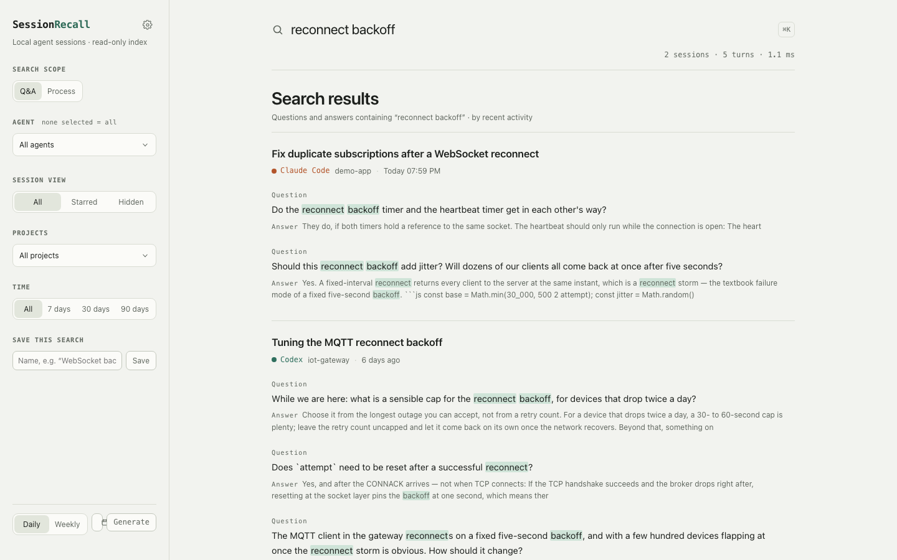
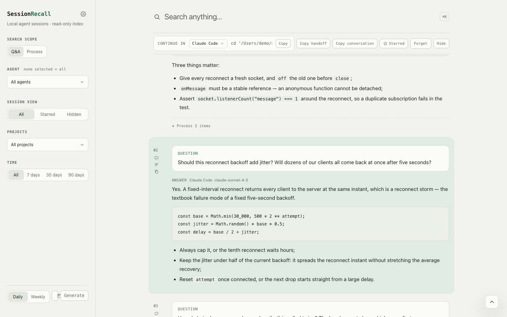
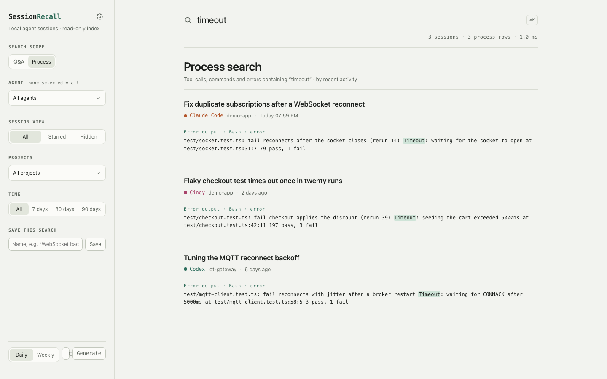

# Session Recall

[English](README.md) | [Chinese](README.zh-CN.md)

[](LICENSE)
[](https://github.com/odinyu/session-recall/actions/workflows/ci.yml)

**You already solved this last month. Find it again in one keystroke.**

A local, read-only index over every coding-agent session on this Mac. One
search box for the question, the answer, the agent, the project and the date —
across 11 agents, with no account and no network call. Press `⌥⌘R` from any app.

> *"How did we fix the websocket reconnect?"* → the session where you did, with
> the answer and the dead end you tried first.

## Why not just grep the session files?

grep finds strings. It does not know a turn from a tool call, does not rank by
relevance, and cannot tell you which question an answer belongs to. Session
Recall indexes turns and tool events separately, so a hit inside a stack trace
takes you to the question that provoked it — and the answer that resolved it.

## What it does

- **Nothing to set up.** First launch indexes what is already on disk: no
  account, no cloud, no API key, no config file.
- **Never writes.** Agent transcripts are opened read-only with a busy timeout;
  the only thing it creates is its own index.
- **Chinese and code in one query.** A trigram index, so 半句中文 and
  `reconnect_backoff` both land, in the same box.
- **Eleven agents, one index.** omp · pi · OpenCode · Cursor · Alma · Cindy ·
  Claude Code · Codex · Gemini CLI · Qwen Code · Goose — plus any other agent you
  declare in a small JSON file (see *Adding your own agent* below).
- **Reports, not just search.** Daily standups, weekly and monthly reports, and a
  handoff card that carries the context into a new agent session.
- **Your agents can use it too.** A stdio MCP server and a portable skill;
  `setup` wires both into the agents installed here.

## Download

| Mac | Download |
| --- | --- |
| Apple silicon (M1/M2/M3/M4…) | [`Session-Recall_macos-arm64.zip`](https://github.com/odinyu/session-recall/releases/latest/download/Session-Recall_macos-arm64.zip) — 27.2 MB |
| Intel | [`Session-Recall_macos-intel.zip`](https://github.com/odinyu/session-recall/releases/latest/download/Session-Recall_macos-intel.zip) — 29.9 MB |

Or let Homebrew do it, which also puts the `session-recall` CLI on your PATH
and skips the quarantine step below:

```bash
brew tap odinyu/tap
brew trust odinyu/tap          # one-time: Homebrew 7 asks before loading a tap
brew install --cask session-recall
```

Otherwise unzip, drag **Session Recall** into `/Applications`, and clear the quarantine
flag once (the build is ad-hoc signed, not notarized):

```bash
xattr -dr com.apple.quarantine "/Applications/Session Recall.app"
open -a "Session Recall"
```

You can also right-click the app and choose **Open**. Requires macOS 11 or
later. Session Recall carries its own runtime — nothing else to install, no
account to create. Updates live under **File → Check for Updates…**.

On first launch it scans the agent stores on this Mac, builds
`~/Library/Application Support/session-recall/index.db`, and refreshes every 90
seconds. There is no setup: projects, agents and dates come from what is already
on disk.

## Adding your own agent

Eleven agents ship with a hand-written parser. For anything else, declare the
store in `~/Library/Application Support/session-recall/sources.json` — no code,
no rebuild:

```json
{
  "sources": [
    {
      "id": "mytool",
      "label": "My Tool",
      "format": "jsonl",
      "root": "~/.mytool/sessions",
      "role": "role",
      "text": "content",
      "time": "created_at",
      "cwd": "meta.cwd",
      "title": "meta.title"
    }
  ]
}
```

That covers a store shaped like most of them: one JSON or JSONL document per
session, a list of messages inside. `format` is `jsonl` (one object per line) or
`json` (one document, array at `messages`), `root` is the directory, and every
other field is a dot path into a record. `userRoles` and `assistantRoles`
override the defaults (`user`/`human`/`prompt` and
`assistant`/`agent`/`ai`/`model`/`bot`). Text can be a string or a list of
blocks under `text`; timestamps can be epoch seconds, milliseconds or ISO.

The next scan picks it up, `--agent mytool` filters by it, and
`session-recall doctor` reports a broken declaration instead of quietly indexing
nothing. Two limits worth knowing: the `id` cannot collide with a built-in
agent, and a SQLite store still needs an adapter in `src/adapters/`.

A filled-in example with every field documented lives in
[`doc/sources.example.json`](doc/sources.example.json).

## Screenshots

Every screenshot is rendered from invented sessions in a throwaway index; the
real index is never read.



A query across every indexed agent: the rail filters by agent, project and time,
and each hit shows the question, the answer, and where the terms matched.



One session, opened through a `?turn=` deep link: the addressed question is
highlighted, its answer follows, and the continue-in strip carries the resume
command.



Process search looks past the prose into tool calls, commands and error output,
which is how a failing run behind a conversation gets found.

## Handoff card

Every session page has **Copy handoff** in the sticky action bar. It copies a
Markdown card for another agent or a scratchpad: project, agent, time range,
resume command (or Alma deep link), the last few prompts, the last answer, files
touched, commands run, tool errors, and the current Git branch/status. The card
is generated from the local index and never uploaded.

**Continue in** creates the same context for another agent. Five agents have an
exact in-place resume command — omp, pi, OpenCode, Claude Code and Codex — and
Alma opens its own threads with `alma://thread/<id>`. Every other agent gets a
command that starts a new session (or opens the project) plus the handoff card
to paste as context.

## Reports

The sidebar footer generates **daily** and **weekly** reports: pick a day, choose
Daily or Weekly, press **Generate**. A report opens in the content pane and can
be downloaded as Markdown.

Monthly reports and period comparisons come from the command-line tool bundled
inside the app:

```bash
SR="/Applications/Session Recall.app/Contents/MacOS/session-recall"
"$SR" brief --month 2026-11
```

Reports are written under `~/Library/Application Support/session-recall/brief/`
(`daily/`, `weekly/`, `monthly/`). `briefSchedule` in `prefs.json` can generate
the current daily or weekly report on a local timer; the Settings drawer does not
expose it yet.

<details>
<summary><b>Search</b> — scopes, filters, sorting and the API</summary>

- **Q&A** searches prompts, answers and session titles. **Process** searches
  tool inputs (`path`, `command`, …), tool outputs and extracted error lines.
  Reasoning stays out of search.
- SQLite FTS5 with a `trigram` index for Chinese phrases and substring/code
  identifiers, plus `porter` stemming for English. Queries under three
  characters fall back to indexed `LIKE`.
- <kbd>⌘⇧K</kbd> opens quick search from anywhere in the app (rebindable):
  <kbd>↑↓</kbd> move, <kbd>Enter</kbd> opens, <kbd>⌘↵</kbd> copies the deep link,
  <kbd>Esc</kbd> closes.
- Filters: agent, project, date range, role (prompt / answer / both), starred
  and hidden. The role filter is hidden in the process scope.
- Results group by session and sort by the session's last activity, newest
  first. A process hit opens its turn and expands the matching tool row; an
  answer hit scrolls to the answer.
- The first screen loads 200 rows; the footer offers **Show more** up to 5,000.
- API: `GET /api/search?q=…&scope=qa|process&agent=…&project=…&from=…&to=…&role=…`.

</details>

<details>
<summary><b>What gets indexed</b> — 11 agents and their local stores</summary>

| Agent | Source | Extract |
|---|---|---|
| omp | `~/.omp/agent/sessions/<cwd>/*.jsonl` (plus profile roots) | user/assistant text; titles |
| pi | `~/Library/Application Support/CindyGlobal/pi-agent-home/sessions/*.jsonl`, `.../pi-package-home/sessions/*.jsonl`, `~/.pi/agent/sessions/*.jsonl` | pi shares omp's JSONL format: turns, thinking and tool calls become text + process events |
| OpenCode | `~/.local/share/opencode/opencode.db` | `session_v2` + `session_message` (falls back to the v1 tables) |
| Cursor | `~/.cursor/projects/*/agent-transcripts/**/*.jsonl` and `state.vscdb` | transcripts first, KV for chats without one; project from `workspaceIdentifier` |
| Alma | `~/Library/Application Support/alma/chat_threads.db` | `chat_threads` + `chat_messages`; incognito threads never listed |
| Cindy | `~/Library/Application Support/CindyGlobal/cindy-*.db` | `sessions` + `messages`; thinking/tool rows become process events; rewound and cleared messages excluded |
| Claude Code | `~/.claude/projects/<project-slug>/<sessionId>.jsonl` | text, thinking and tool calls; `tool_result` attaches to its call; subagent sidechains skipped |
| Codex | `~/.codex/sessions/YYYY/MM/DD/rollout-*.jsonl`, plus Cindy's `codex-home` | `session_meta` + `turn_context`; response items, calls and reasoning become turns + process events |
| Gemini CLI | `~/.gemini/tmp/<project>/chats/session-*.jsonl` | user/gemini messages, thoughts and tool calls; edit records and subagent chats skipped |
| Qwen Code | `~/.qwen/projects/<project>/chats/<sessionId>.jsonl` | Gemini-lineage records; `message.parts`, thoughts and function calls become turns + events |
| Goose | `~/Library/Application Support/goose/sessions/sessions.db` | `sessions` + `messages`; text/thinking/tool blocks, hidden rows skipped |

The index unit is a **turn**: one prompt plus the assistant text before the next
prompt. Tool calls and reasoning live as process events under that turn. Each
turn also stores the model when the agent records one; Cursor and Goose
limitations are listed under Known limits.

</details>

<details>
<summary><b>Process events</b> — tool calls, commands and errors</summary>

When a turn has tool calls or reasoning, its row shows a **Process**
disclosure. Opening it loads that turn's events lazily; each reasoning block and
tool call is a collapsed row, and inputs/outputs are plain text.

- Events are keyed by `(session_id, turn_idx, seq)` and capped at 30 per turn,
  1,200 per session; reasoning 2,000 characters, input 1,000, output 2,000.
- omp/pi pair results by id; OpenCode reads tool state; Cursor transcripts
  usually carry no results; Alma reads `tool-<Name>` parts and shows status
  (`ok`, `error`, `denied`, `input-available`, `input-streaming`).
- API: `GET /api/session/:id/events?turn=N`.
- Process search links carry `event=<seq>`, so opening a hit expands the turn,
  opens the matching row and scrolls it under the sticky action bar.

</details>

<details>
<summary><b>Resume commands</b> — exact commands for the five supported agents</summary>

```bash
cd '/path/to/project' && omp --resume <session-uuid>
cd '/path/to/project' && opencode --session <session-id>
cd '/path/to/project' && claude --resume <session-id>
cd '/path/to/project' && pi --session <session-uuid>
cd '/path/to/project' && codex resume <session-uuid>
alma://thread/<thread-id>
```

Paths are shell-quoted. For omp and pi the id is the uuid after the timestamp in
the stored filename; for Codex it is the trailing rollout uuid. Cross-agent
handoff cannot transfer a session id — the target starts a new session and the
handoff card supplies the context.

</details>

<details>
<summary><b>Connect your agents</b> — one command, two channels</summary>

The app ships a stdio MCP server and an agent skill. Point both at every agent
on this machine:

```bash
sr="/Applications/Session Recall.app/Contents/MacOS/session-recall"
"$sr" setup --dry-run   # show the plan, write nothing
"$sr" setup             # write the MCP entry and the skill (backups included)
"$sr" doctor            # verify - including a real MCP initialize + tools/list
```

`setup` writes the MCP entry only for clients whose config shape is verified
(Cursor, Alma, Claude Code, Gemini CLI, Qwen Code, OpenCode) and prints a
paste-ready snippet for the rest. The skill is the portable channel: the same
`SKILL.md` lands in `~/.agents/skills`, `~/.claude/skills`, `~/.codex/skills`,
`~/.cursor/skills` and `~/.config/opencode/skills`, so agents with shell access
can use the CLI even when they cannot take an MCP entry.

Neither channel touches your transcripts. Every config file is backed up before
it is edited, a file that is not valid JSON is reported and left alone, and
`setup --remove` takes back only what it installed.

Tools: `recall_search`, `recall_session`, `recall_facets`, `recall_handoff`,
`recall_scan`, `recall_saved_searches`, `recall_brief`. Read tools open the index
read-only and refresh it in the background when the last scan is older than five
minutes; every reply reports `refresh` and `indexAgeMs`.

</details>

<details>
<summary><b>Privacy and the index</b></summary>

- Index: `~/Library/Application Support/session-recall/index.db` (SQLite WAL).
- Preferences: `<app dir>/prefs.json` — theme, language, hotkey, in-app
  shortcuts, update check and report schedule; written atomically.
- Agent databases are opened `readonly: true` with a busy timeout. Nothing in
  their folders is modified or copied. Incognito Alma threads are excluded in
  SQL before their messages are read.
- Indexing, search, reports, handoff cards and MCP make no network calls and
  need no account. The only outbound request is the GitHub update check (launch,
  every six hours, and **Check for Updates…**); set `"checkUpdates": false` in
  `prefs.json` to stop it.
- Secrets are redacted before rows are written: API keys, Bearer tokens, JWTs,
  PEM private keys, `KEY=value` credentials, connection strings with embedded
  credentials, e-mail addresses and Chinese mobile numbers become placeholders
  such as `[REDACTED:api-key]`.
- Override paths with `SESSION_RECALL_DB`, `SESSION_RECALL_HOME`,
  `SESSION_RECALL_PORT`, `SESSION_RECALL_BRIEF_DIR` and
  `SESSION_RECALL_WEB_DIST`.

Drop a session without touching its transcript:

```bash
SR="/Applications/Session Recall.app/Contents/MacOS/session-recall"
"$SR" forget omp:2026-11-10T01-13-16-427Z_01a1c304    # rows + FTS
"$SR" unforget omp:2026-11-10T01-13-16-427Z_01a1c304  # undo
```

The same action is **Forget this session** on the session page, with Undo in the
status line.

</details>

<details>
<summary><b>Known limits</b></summary>

- **Cursor tool results**: transcripts usually have calls but no results, so
  Cursor process rows show input without output.
- **Cursor timestamps**: project transcripts carry no top-level timestamps, so
  activity falls back to file modification time. Chats whose project no longer
  exists are indexed without a project path.
- **Alma branches**: edit/regenerate leaves sibling messages; the adapter
  flattens them by time instead of resolving the active branch. Alma subagent
  transcripts fold into the surrounding turn.
- **Cindy pairing**: results carry no tool id, so outputs attach to the oldest
  unanswered call in arrival order.
- **Claude Code subagents**: `isSidechain` records are skipped and their work is
  not indexed separately.
- **Codex format**: follows the documented rollout format; field names may drift
  between Codex releases.
- **WorkBuddy** stores metadata only, so it is not indexed.
- **Archived chats** are included; there is no archive filter yet.

</details>

<details>
<summary><b>Documentation and building from source</b></summary>

- [`doc/BUILD.md`](doc/BUILD.md) — build the `.app`, run tests, project layout.
- [`doc/USAGE.md`](doc/USAGE.md) — every CLI and MCP option, JSON schemas, exit codes.
- [`doc/MCP.md`](doc/MCP.md) — sharing one index with a stdio MCP client.
- [`doc/REPORTS.md`](doc/REPORTS.md) — daily, weekly and monthly templates.
- [`doc/DESIGN.md`](doc/DESIGN.md) — layout, type scale, tokens, interactions.
- [`doc/PRODUCT.md`](doc/PRODUCT.md) — what Session Recall is and is not.
- [`doc/POSITIONING.md`](doc/POSITIONING.md) — the landscape and roadmap.

</details>

## License

MIT — see [LICENSE](LICENSE).
