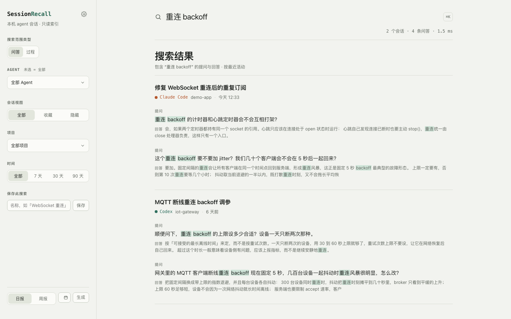
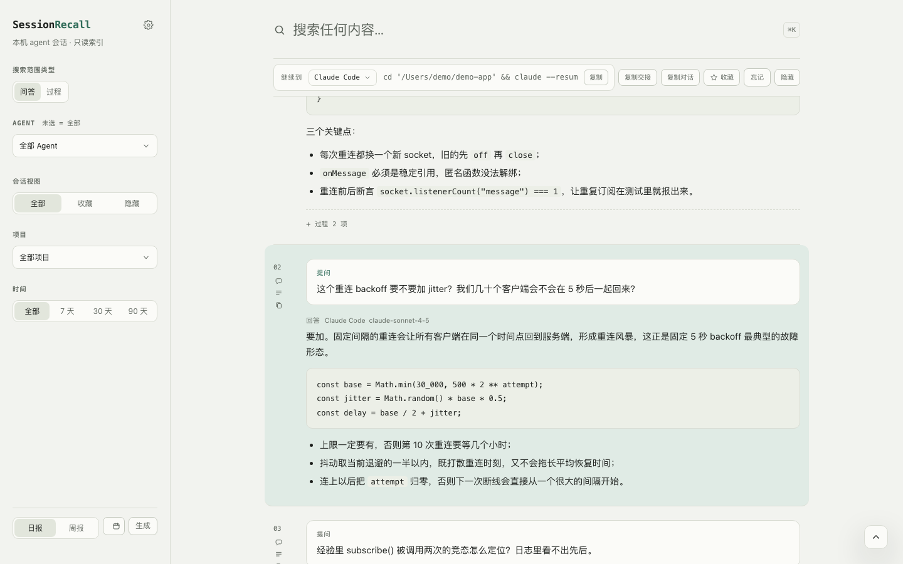

# Session Recall

[English](README.md) | [简体中文](README.zh-CN.md)

[](LICENSE)
[](https://github.com/odinyu/session-recall/actions/workflows/ci.yml)

**所有会话，一搜即得。** 一个面向本机 coding agent 会话的本地、只读全文索引。想起
半句中文或一个代码标识符，就能找回当时的提问、回答、agent、项目和日期。

为 **omp**、**pi**、**OpenCode**、**Cursor**、**Alma**、**Cindy**、
**Claude Code**、**Codex**、**Gemini CLI**、**Qwen Code**、**Kimi Code**、
**Copilot CLI** 和 **Goose** 积累的会话而做。它从不写入 agent 自己的存储。

## 下载

| Mac | 下载 |
| --- | --- |
| Apple 芯片（M1/M2/M3/M4…） | [`Session-Recall_macos-arm64.zip`](https://github.com/odinyu/session-recall/releases/latest/download/Session-Recall_macos-arm64.zip)——28.5 MB |
| Intel | [`Session-Recall_macos-intel.zip`](https://github.com/odinyu/session-recall/releases/latest/download/Session-Recall_macos-intel.zip)——31.4 MB |

解压后把 **Session Recall** 拖进 `/Applications`，首次启动前清除一次 quarantine
标记（构建是 ad-hoc 签名、未公证）：

```bash
xattr -dr com.apple.quarantine "/Applications/Session Recall.app"
open -a "Session Recall"
```

也可以右键应用选「打开」。需要 macOS 11 或更高版本。Session Recall 自带运行环境，
不需要额外安装任何东西，也不需要账号。更新在菜单 **文件 → 检查更新…**。

首次启动会扫描本机的 agent 存储，建立
`~/Library/Application Support/session-recall/index.db`，之后每 90 秒刷新。没有任何
配置步骤：侧栏里的项目、agent 和日期都来自磁盘上已有的内容。

## 截图

截图全部来自临时索引里的虚构会话；真实索引从不读取。



一次跨所有 agent 的中英混合查询：左侧栏按 agent、项目和时间筛选，每条命中显示
提问、回答，以及匹配词出现的位置。



单个会话，通过 `?turn=` 深链跳到某一轮：被定位的提问高亮，回答紧随其后，顶部继续栏
给出准确的恢复命令。


过程搜索会越过正文，进入工具调用、命令和错误输出，因此能找回一次对话背后失败的运行。

## 交接卡

每个会话页的粘性操作栏里都有 **复制交接**。它复制一张 Markdown 卡片，可粘贴到另一个
agent 或草稿区：项目、agent、时间范围、恢复命令（或 Alma 深链）、最近几次提问、
最后一次回答、改过的文件、运行过的命令、工具错误，以及 Git 分支/状态。卡片从本地
索引生成，不会上传。

**继续到** 为另一个 agent 准备同样的上下文。只有 5 个 agent 有精确的原位恢复命令
——omp、pi、OpenCode、Claude Code 和 Codex；Alma 用 `alma://thread/<id>` 打开自己的
线程。其余 agent 得到的是新开会话（或打开项目）的命令，加上粘贴即可用的交接卡。

## 报告

侧栏底部生成 **日报** 和 **周报**：选一天，选择日报或周报，按 **生成**。报告在内容区
打开，也可以下载 Markdown。

月报与周期对比使用应用包里的命令行工具：

```bash
SR="/Applications/Session Recall.app/Contents/MacOS/session-recall"
"$SR" brief --month 2026-11
```

报告写在 `~/Library/Application Support/session-recall/brief/`（`daily/`、
`weekly/`、`monthly/`）。`prefs.json` 的 `briefSchedule` 可以按本地定时生成当天的
日报或周报；设置里暂未暴露这个开关。

<details>
<summary><b>搜索</b>——范围、筛选、排序与 API</summary>

- **问答** 搜索提问、回答和会话标题；**过程** 搜索工具输入（`path`、`command` 等）、
  工具输出和提取出的错误行。推理文本不进入搜索。
- SQLite FTS5：`trigram` 负责中文短语和子串/代码标识符，`porter` 作为英文词干回退；
  少于三个字符的查询回退到索引 `LIKE`。
- <kbd>⌘⇧K</kbd> 随时打开快速搜索（可改绑）：<kbd>↑↓</kbd> 移动，<kbd>Enter</kbd>
  打开，<kbd>⌘↵</kbd> 复制深链，<kbd>Esc</kbd> 关闭。
- 筛选：agent、项目、日期范围、角色（提问/回答/两者）、收藏与隐藏。过程范围隐藏角色
  筛选。
- 结果按会话分组，按最后活动时间从新到旧；会话内也按新到旧，FTS rank 作为并列裁决。
  过程命中会打开对应轮次并展开匹配的工具行；回答命中滚到回答块。
- 首屏 200 条，列表底部提供 **显示更多**，最多 5,000 条。
- API：`GET /api/search?q=…&scope=qa|process&agent=…&project=…&from=…&to=…&role=…`。

</details>

<details>
<summary><b>索引哪些内容</b>——13 个 agent 与它们的本地存储</summary>

| Agent | 来源 | 提取 |
|---|---|---|
| omp | `~/.omp/agent/sessions/<cwd>/*.jsonl`（加 profile 根目录） | 用户/助手文本；标题 |
| pi | `~/Library/Application Support/CindyGlobal/pi-agent-home/sessions/*.jsonl`、`.../pi-package-home/sessions/*.jsonl`、`~/.pi/agent/sessions/*.jsonl` | 与 omp 共用 JSONL 格式：turn、thinking 和 tool call 变成文本 + 过程事件 |
| OpenCode | `~/.local/share/opencode/opencode.db` | `session_v2` + `session_message`（回退到 v1 表） |
| Cursor | `~/.cursor/projects/*/agent-transcripts/**/*.jsonl` 和 `state.vscdb` | 优先 transcript，没 transcript 读 KV；项目路径来自 `workspaceIdentifier` |
| Alma | `~/Library/Application Support/alma/chat_threads.db` | `chat_threads` + `chat_messages`；无痕线程不列出 |
| Cindy | `~/Library/Application Support/CindyGlobal/cindy-*.db` | `sessions` + `messages`；thinking/tool 行变成过程事件；回退与清除前的消息排除 |
| Claude Code | `~/.claude/projects/<project-slug>/<sessionId>.jsonl` | 文本、thinking 和工具调用；`tool_result` 挂到对应调用；子代理 sidechain 跳过 |
| Codex | `~/.codex/sessions/YYYY/MM/DD/rollout-*.jsonl`，以及 Cindy 的 `codex-home` | `session_meta` + `turn_context`；消息、调用和推理变成 turn + 过程事件 |
| Gemini CLI | `~/.gemini/tmp/<project>/chats/session-*.jsonl` | 用户/gemini 消息、thoughts 和工具调用；编辑记录和子代理对话跳过 |
| Qwen Code | `~/.qwen/projects/<project>/chats/<sessionId>.jsonl` | Gemini 一脉记录；`message.parts`、thought 和 function call 变成 turn + 事件 |
| Kimi Code | `~/.kimi/sessions/<workdir-digest>/<sessionId>/wire.jsonl`，以及 `~/.kimi-code` | prompt/text/工具信封；控制与 UI 事件跳过 |
| Copilot CLI | `~/.copilot/session-state/<session-id>/events.jsonl` | 用户/助手消息、工具请求与完成；加密载荷跳过 |
| Goose | `~/Library/Application Support/goose/sessions/sessions.db` | `sessions` + `messages`；text/thinking/tool 块，隐藏行跳过 |

索引单位是 **turn**：一次用户提问，加上下一个提问之前的助手文本。工具调用和推理作为
该 turn 下的过程事件存储。每个 turn 还会在 agent 记录时保存所用模型；Cursor、Goose
和 Kimi Code 的限制见「已知限制」。

</details>

<details>
<summary><b>过程事件</b>——工具调用、命令与错误</summary>

当某个 turn 有工具调用或推理时，它的转录行会显示 **过程** 折叠入口。展开时按需加载
该 turn 的事件；每个推理块和工具调用是一行可折叠记录，输入/输出按纯文本显示。

- 事件按 `(session_id, turn_idx, seq)` 存储，每 turn 最多 30 个、每会话 1,200 个；
  推理截到 2,000 字符，输入 1,000，输出 2,000。
- omp/pi 按 id 配对结果；OpenCode 读工具状态；Cursor transcript 通常没有结果；Alma
  直接读 `tool-<Name>` part，并显示状态（`ok`、`error`、`denied`、
  `input-available`、`input-streaming`）。
- API：`GET /api/session/:id/events?turn=N`。
- 过程搜索链接带 `event=<seq>`，打开后展开该 turn、打开匹配行并滚到粘性操作栏下方。

</details>

<details>
<summary><b>恢复命令</b>——5 个支持原位恢复的 agent</summary>

```bash
cd '/path/to/project' && omp --resume <session-uuid>
cd '/path/to/project' && opencode --session <session-id>
cd '/path/to/project' && claude --resume <session-id>
cd '/path/to/project' && pi --session <session-uuid>
cd '/path/to/project' && codex resume <session-uuid>
alma://thread/<thread-id>
```

路径会做 shell 引号处理。omp 和 pi 的 id 是文件名中时间戳之后的 uuid；Codex 是
rollout 文件末尾的 uuid。跨 agent 交接不能传递 session id——目标 agent 新开会话，由
交接卡提供上下文。

</details>

<details>
<summary><b>接入你的 agent</b>——一条命令，两条通道</summary>

应用包内置 stdio MCP server 和一份 agent skill。一条命令接上本机所有 agent：

```bash
sr="/Applications/Session Recall.app/Contents/MacOS/session-recall"
"$sr" setup --dry-run   # 只打印计划，不写任何文件
"$sr" setup             # 写入 MCP 条目和 skill（自动备份）
"$sr" doctor            # 自检，含真实的 MCP initialize + tools/list 握手
```

`setup` 只为形状已验证的客户端写 MCP 条目（Cursor、Alma、Claude Code、Gemini CLI、
Qwen Code、OpenCode），其余的给可直接粘贴的片段。skill 是可移植的那条通道：同一份
`SKILL.md` 落到 `~/.agents/skills`、`~/.claude/skills`、`~/.codex/skills`、
`~/.cursor/skills`、`~/.config/opencode/skills`，所以有 shell 权限的 agent 即使接不了
MCP 条目也能用 CLI。

两条通道都不碰你的会话记录。每个被改的配置文件都先备份；不是合法 JSON 的文件只报告、
原样保留；`setup --remove` 只收回它自己装的东西。

工具：`recall_search`、`recall_session`、`recall_facets`、`recall_handoff`、
`recall_scan`、`recall_saved_searches`、`recall_brief`。读工具以只读方式打开索引；
上次扫描超过 5 分钟时在后台刷新，每次回复都带 `refresh` 和 `indexAgeMs`。

</details>

<details>
<summary><b>隐私与索引</b></summary>

- 索引：`~/Library/Application Support/session-recall/index.db`（SQLite WAL）。
- 偏好：`<app dir>/prefs.json`——主题、语言、热键、应用内快捷键、更新检查与报告定时；
  原子写入。
- Agent 数据库以 `readonly: true` 和 busy timeout 打开，源目录内容不会被修改或复制。
  Alma 的无痕线程在读取消息前就在 SQL 里排除。
- 索引、搜索、报告、交接卡和 MCP 都不发网络请求，也不需要账号。唯一的外发请求是
  GitHub 更新检查（启动时、每 6 小时、以及「检查更新…」）；在 `prefs.json` 里设
  `"checkUpdates": false` 可关闭。
- 写入前会脱敏：API key、Bearer token、JWT、PEM 私钥、`KEY=value` 凭据、带凭据的
  连接串、邮箱和中国手机号都会变成 `[REDACTED:api-key]` 这类占位符。
- 路径可用 `SESSION_RECALL_DB`、`SESSION_RECALL_HOME`、`SESSION_RECALL_PORT`、
  `SESSION_RECALL_BRIEF_DIR`、`SESSION_RECALL_WEB_DIST` 覆盖。

不想再被搜索的会话可以在不碰原始 transcript 的情况下移出索引：

```bash
SR="/Applications/Session Recall.app/Contents/MacOS/session-recall"
"$SR" forget omp:2026-11-10T01-13-16-427Z_01a1c304    # rows + FTS
"$SR" unforget omp:2026-11-10T01-13-16-427Z_01a1c304  # undo
```

同一操作也是会话页上的「忘记此会话」，状态行提供「撤销」。

</details>

<details>
<summary><b>已知限制</b></summary>

- **Cursor 工具结果**：transcript 通常有调用但没有结果，所以过程行只有输入没有输出。
- **Cursor 时间戳**：项目 transcript 没有顶层时间戳，活跃日期回退到文件修改时间；
  项目已不存在的聊天会索引但没有项目路径。
- **Alma 分支**：编辑/重新生成会留下兄弟消息，适配器按时间展开而不解析活跃分支；
  子代理 transcript 会折进周围 turn。
- **Cindy 配对**：结果没有工具 id，输出按到达顺序挂到最老的未回答调用。
- **Claude Code 子代理**：`isSidechain` 记录跳过，其工作不会被单独索引。
- **Codex 格式**：遵循文档化的 rollout 格式，字段名仍可能随版本漂移。
- **Kimi Code** 不记录模型；**WorkBuddy** 只存元数据，暂不索引。
- **归档聊天** 会包含；目前没有归档过滤。

</details>

<details>
<summary><b>文档与从源码构建</b></summary>

- [`doc/BUILD.zh-CN.md`](doc/BUILD.zh-CN.md)——构建 `.app`、运行测试、项目结构。
- [`doc/USAGE.zh-CN.md`](doc/USAGE.zh-CN.md)——所有 CLI 与 MCP 选项、JSON schema、退出码。
- [`doc/MCP.zh-CN.md`](doc/MCP.zh-CN.md)——与 stdio MCP 客户端共用索引。
- [`doc/REPORTS.zh-CN.md`](doc/REPORTS.zh-CN.md)——日报、周报和月报模板。
- [`doc/DESIGN.zh-CN.md`](doc/DESIGN.zh-CN.md)——布局、字号、token 与交互规则。
- [`doc/PRODUCT.zh-CN.md`](doc/PRODUCT.zh-CN.md)——Session Recall 是什么、不是什么。
- [`doc/POSITIONING.zh-CN.md`](doc/POSITIONING.zh-CN.md)——工具定位与路线图。

</details>

## License

MIT —— 见 [LICENSE](LICENSE)。
