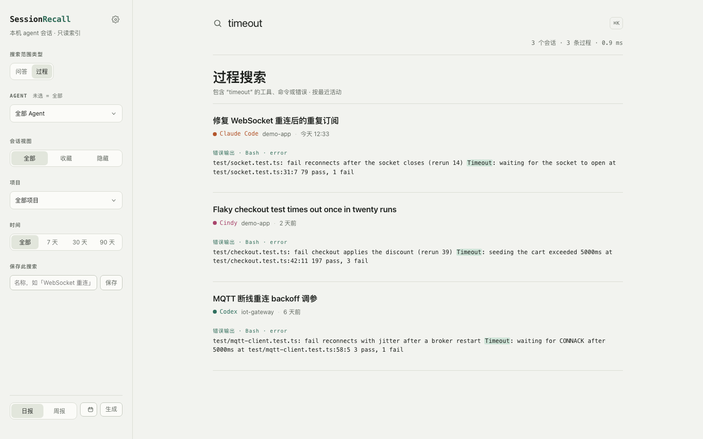

# session recall

[English](README.md) | [简体中文](README.zh-CN.md)

[](LICENSE)
[](https://github.com/odinyu/session-recall/actions/workflows/ci.yml)

**所有会话，一搜即得。** 一个面向本机 coding agent 会话的本地、只读全文索引。想起半句中文或一个代码标识符，就能找回当时的提问、回答、agent、项目和日期。

为 **omp**、**pi**、**OpenCode**、**Cursor**、**Alma**、**Cindy**、**Claude Code**、**Codex**、**Gemini CLI**、**Qwen Code**、**Kimi Code**、**Copilot CLI** 和 **Goose** 这些工具积累下来的会话而做。它从不写入 agent 自己的存储。

## 下载

每次 [release](https://github.com/odinyu/session-recall/releases) 都附有构建好的
macOS 应用。按芯片选一个：

| Mac | 下载 |
| --- | --- |
| Apple 芯片（M1/M2/M3/M4…） | [`Session-Recall_macos-arm64.zip`](https://github.com/odinyu/session-recall/releases/latest/download/Session-Recall_macos-arm64.zip)——28.5 MB |
| Intel | [`Session-Recall_macos-intel.zip`](https://github.com/odinyu/session-recall/releases/latest/download/Session-Recall_macos-intel.zip)——31.4 MB |

解压后把 **Session Recall** 拖进 `/Applications`，首次启动前清除一次 quarantine
标记（构建是 ad-hoc 签名、未公证）：

```bash
xattr -dr com.apple.quarantine "/Applications/Session Recall.app"
open -a "Session Recall"
```

也可以右键应用选「打开」。需要 macOS 11 或更高版本。应用自带运行环境，不需要额外
安装任何东西，也不需要账号。更新是内置的：菜单 **文件 → 检查更新…**，有新版本时
应用里也会提示。

## 首次启动

打开应用，它会扫描本机的 agent 存储，建立
`~/Library/Application Support/session-recall/index.db`，之后每 90 秒刷新。没有
任何配置步骤：侧栏里的项目、agent 和日期都来自磁盘上已有的内容。

左侧栏底部可以在 Auto（跟随 macOS）、Light、Dark 之间切换主题，也可以在 Auto
（跟随浏览器）、中文和 English 之间切换界面语言；选择保存在
`<app dir>/prefs.json`，换端口重启后仍然保留。偏好 API：`GET /api/prefs`，以及
`PATCH /api/prefs` 传 `{"theme": …}` 或 `{"language": …}`（`auto`/`light`/`dark`，
`auto`/`zh`/`en`），其他值返回 400。

## 能做什么

- **一次搜全部。** 提问、回答、会话标题，以及**过程**范围里的工具输入、命令和
  错误输出，都在这一个查询里；覆盖 13 个 coding agent。中文短语、代码标识符和
  路径都能搜。
- **直接跳到那一刻。** 命中会打开会话的对应轮次并高亮匹配文字；过程命中还会展开
  对应的工具行。
- **换个 agent 接着做。**「继续到」为 5 个支持恢复命令的 agent 生成原位命令；其余
  agent 给出交接卡（项目、改过的文件、跑过的命令、报错、Git 分支），粘贴即可接力。
- **不离开键盘。** <kbd>⌘⇧K</kbd> 打开快速搜索；全局快捷键（默认 <kbd>⌥⌘R</kbd>）
  可在任何应用里唤起窗口。两者和 <kbd>⌘K</kbd> 都可改绑，且即时生效。
- **回看这一周。** 侧栏可生成日报和周报；月报与周期对比可通过命令行和 HTTP API
  生成。
- **让 agent 自己来查。** 内置 MCP server 通过 stdio 把同一份索引交给 Claude、
  Codex 等 MCP 客户端。

## 实现方式

窗口是一个原生 macOS 外壳，里面是监听随机 loopback 端口的本地服务；同一份二进制
也负责索引和 MCP server，并打包在应用内。Agent 存储以只读方式打开，不会复制出去。
`sessionrecall://session/<id>?turn=<n>` 链接会打开应用并落到那一轮。

## 快捷键

应用会注册一个全局快捷键（默认 `⌥⌘R`），在任何应用里都能显示或隐藏窗口。设置抽屉
的「快捷键」区可直接改绑：点 `×` 清除，点 `+` 后按下组合键即可；「聚焦搜索框」
（默认 `⌘K` / `/`）和「快速搜索浮窗」（默认 `⌘⇧K`）也在同一处修改。改动即时生效，
无需重启。已知的 macOS 限制：在某些 macOS 版本上，重复注册可以静默共存——另一个
应用（或本应用的第二个副本）占用同一组合键时不会报错。

## 从源码构建

构建、测试和打包 `.app` 的过程见
[`doc/BUILD.zh-CN.md`](doc/BUILD.zh-CN.md)。从 release 下载的应用不需要这些步骤。

## 截图

下面的截图全部来自 `scripts/capture-screenshots.sh` 写入临时索引的少量虚构会话；真实索引从不读取，也从不截图。


一次跨所有 agent 的中英混合查询：左侧栏按 agent、项目和时间筛选，每条命中显示提问、回答，以及匹配词出现的位置。


单个会话，通过 `?turn=` 深链跳到深色主题下的某一轮：被定位的提问高亮，回答紧随其后，顶部继续栏给出准确的恢复命令。



过程搜索会越过正文，进入工具调用、命令和错误输出，因此能找回一次对话背后失败的运行。

## 索引哪些内容

| Agent | 来源 | 提取 |
|---|---|---|
| omp | `~/.omp/agent/sessions/<cwd>/*.jsonl`（加 profile 根目录） | 用户/助手文本消息；标题 |
| pi | `~/Library/Application Support/CindyGlobal/pi-agent-home/sessions/*.jsonl`、`.../pi-package-home/sessions/*.jsonl`、`~/.pi/agent/sessions/*.jsonl` | 官方 pi 与 omp 共用 JSONL 格式：turn、thinking 和 tool call 变成文本 + 过程事件 |
| OpenCode | `~/.local/share/opencode/opencode.db` | `session_v2` + `session_message`（回退到 v1 的 `session`/`message`/`part` 表） |
| Cursor | `~/.cursor/projects/*/agent-transcripts/**/*.jsonl` 和 `state.vscdb`（`composerData` + `bubbleId`） | 优先读 transcript；没有 transcript 的聊天读 KV；项目路径来自 `workspaceIdentifier` |
| Alma | `~/Library/Application Support/alma/chat_threads.db` | `chat_threads` + `chat_messages`（消息 JSON 的 `parts`）；项目路径来自 `workspaces.path`；`is_incognito` 的线程不列出 |
| Cindy | `~/Library/Application Support/CindyGlobal/cindy-*.db`（取最新的匹配文件） | `sessions` + `messages`：用户行是 JSON `{text}` 或 Orca 任务 `{orcaSource, content}`，助手行是纯文本，`thinking`/`tool_use`/`ask_user` 行变成过程事件；项目路径来自 `working_dir`；`rewind_at` 和 `cleared_at` 之前的消息排除 |
| Claude Code | `~/.claude/projects/<project-slug>/<sessionId>.jsonl` | `user`/`assistant` 记录带 Anthropic content block：text、`thinking`、`tool_use` 变成 turn + 过程事件，`tool_result` 用户记录挂到对应调用；标题来自 `ai-title`；项目路径来自 `cwd`；跳过 `isSidechain` 子代理记录 |
| Codex | `~/.codex/sessions/YYYY/MM/DD/rollout-*.jsonl`，以及 Cindy 的 `CindyGlobal/codex-home/sessions` 和 `.../archived_sessions` | `session_meta` + `turn_context` 提供 cwd/model；`response_item` 消息、`function_call`/`*_output`、`reasoning` 变成 turn + 过程事件；没有 `response_item` 消息时才回退到 `event_msg` 回显 |
| Gemini CLI | `~/.gemini/tmp/<project>/chats/session-*.jsonl`（`$GEMINI_DATA_DIR` 可改根目录；旧版本把同一段对话写成一个 `.json` 文件） | `user` 消息开启 turn，`gemini` 消息提供正文、`model`、`thoughts` 和 `toolCalls`（名称、`args`、`result`、`status`），变成 turn + 过程事件；跳过 `info`/`error` 提示和 `$patch`/`$set`/`$rewindTo` 编辑记录；标题取首个提问；项目路径取 `.project_root` 标记文件（回退到 `projects.json` 注册表）；`chats/<parentSessionId>/` 下的子代理对话跳过 |
| Qwen Code | `~/.qwen/projects/<project>/chats/<sessionId>.jsonl`（`$QWEN_DATA_DIR` 可改根目录） | Gemini CLI 一脉的记录，`type` 为 `user`/`assistant`/`tool_result`/`system`：`message.parts` 里的文本、`thought` 块和 `functionCall` 调用变成 turn + 过程事件，`functionResponse` 回填对应调用的输出；标题取 `custom_title` 系统记录；项目路径取每条记录的 `cwd`；`system`/`external_agent` 来源或 `agent_*` 子类型的用户记录跳过 |
| Kimi Code | `~/.kimi/sessions/<workdir-digest>/<sessionId>/wire.jsonl`，以及 `~/.kimi-code`（`$KIMI_DATA_DIR` 可同时改这两处） | wire 信封 `{timestamp, message: {type, payload}}`：`TurnBegin`/`SteerInput` 提问、`ContentPart` 的文本与 `think` 块、`ToolCall`/`ToolResult` 配对，变成 turn + 过程事件；`Step*`、`TurnEnd`、`StatusUpdate`、`Notification`、`Approval*`、`Question*` 等控制与 UI 事件跳过；标题取 `state.json` 的 `custom_title`；项目路径用 `kimi.json` 里 `work_dirs` 的 md5 摘要匹配；`agents/*/wire.jsonl` 下的子代理记录跳过 |
| Copilot CLI | `~/.copilot/session-state/<session-id>/events.jsonl`（`$COPILOT_HOME` 可改根目录；1.0.11 之前是扁平的 `<session-id>.jsonl`，另加 `history-session-state`） | `user.message` 开启 turn，`assistant.message` 提供正文、`model` 和 `toolRequests`，`tool.execution_complete` 回填调用输出；`session.*`、`assistant.turn_*`/`assistant.reasoning`、`hook.*`、`subagent.*` 和加密载荷跳过；标题取 `workspace.yaml` 的 `name`；项目路径取 `session.start` 的 `cwd` 或 `workspace.yaml` |
| Goose | `~/Library/Application Support/goose/sessions/sessions.db`（`$GOOSE_PATH_ROOT/data/sessions/sessions.db`，Linux 为 `~/.local/share/goose/sessions` 或 `~/.local/share/Block/goose/sessions`，只读打开） | `sessions` + `messages`：`content_json` 的文本和 `thinking` 块变成 turn + 过程事件，`toolRequest`/`toolResponse` 块按 id 配对；`metadata_json.userVisible` 为 `false` 的行跳过；标题取 `sessions.name`，其次 `description`；项目路径取 `working_dir`；列用 `PRAGMA table_info` 探测 |

索引单位是 **turn**：一次用户提问，加上下一个提问之前紧跟的助手文本。工具调用和推理轨迹作为过程事件单独存储（见下）；它们的输入、输出和错误可以在 **过程** 范围搜索，推理文本不进入搜索。每个 turn 还会在 agent 记录时保存产生回答的模型。omp、pi、OpenCode、Alma、Cindy、Claude Code、Codex、Gemini CLI、Qwen Code 和 Copilot CLI 按 turn 记录；Gemini CLI 和 Qwen Code 取每条助手消息上标注的模型，Copilot CLI 取每条 `assistant.message` 上的模型（`session.model_change` 作为回退）。Cursor 和 Goose 只记录会话级选择（`composerData.modelConfig.modelName` 和 `model_config_json.model_name`），并盖到该会话每个 turn 上——Cursor 的 transcript 和 KV bubble 没有逐 turn 模型，Cursor 的占位值 `default` 保持空白。Kimi Code 不记录模型。会话页在 agent 徽标旁显示模型。

## 过程

当某个 turn 有工具调用或推理时，它的转录行会显示 `过程` 折叠入口。展开时按需加载该 turn 的事件；每个推理块和工具调用是一行可折叠记录，工具输入/输出按纯文本显示。

- 事件存在 `event` 表，键是 `(session_id, turn_idx, seq)`。
- 限额保证索引有界：每 turn 30 个事件、每会话 1,200 个；推理截到 2,000 字符，工具输入 1,000，工具输出 2,000。长值保留头尾并标记为截断。
- omp 和 pi 按 id 把 `toolResult` 消息挂到 `toolCall`；OpenCode 读工具状态的 `input`/`output`；Cursor transcript 有工具调用，但通常没有结果。
- Alma 直接读每个 `tool-<Name>` part：`input` 序列化为 JSON，`output`（如 `{stdout, stderr, exitCode}` 的对象）也序列化为 JSON。还没产出输出、报错或被用户拒绝的调用保留空输出——不编造内容——状态显示在行上（`ok`、`error`、`denied`、`input-available`、`input-streaming`）。
- API：`GET /api/session/:id/events?turn=N` 返回 `{ turn, events }`。
- 搜索使用和 UI 相同的 `scope` 参数：`scope=process` 搜索工具输入、输出和提取出的错误文本。它按会话分组命中，返回 `processTotal`，以及每条命中的 `tool`、`turnIdx`、`status`、`matchField`（`input`、`output`、`error`）。结果链接带事件序号（`event=<seq>`），打开后展开该 turn 的过程、打开匹配事件行，并把该行滚到粘性操作栏下方。推理刻意不进入搜索。过程索引是 `event_search`（FTS5 `trigram` + `porter`，三字符以下的查询回退到 `LIKE`）；打开旧索引时会自动重建。

## 交接卡

每个会话页的粘性操作栏里都有一个 `复制交接` 按钮。它会复制一张 Markdown 卡片，可粘贴到另一个 agent 或草稿区：项目、agent、时间范围、恢复命令（或 Alma 深链）、最近几次提问、最后一次回答（原文截断）、工具调用涉及的文件、运行过的命令、工具错误，以及项目是 Git worktree 时的当前分支/状态。卡片按需从本地索引生成，不会发送到任何地方。

- API：`GET /api/session/:id/handoff` 返回 Markdown（`text/markdown`）；加 `?targetAgent=<id>` 生成跨 agent 卡片。
- UI 在会话打开时预取卡片，这样复制按钮可以在点击时同步写入剪贴板（在 `navigator.clipboard` 前做异步工作会丢失浏览器的用户激活）。

## 恢复与跨 agent 交接

每个会话页的粘性操作栏里都有一个 `继续到` 选择器。它列出所有支持的 agent，并说明如何在那里继续*这个*会话：

| 目标 | 操作栏显示 |
| --- | --- |
| 同一 agent | 准确的恢复命令，或存在时的应用深链 |
| 另一个 agent | 在该 agent 中新开一个会话的命令，交接卡作为上下文 |

```bash
cd '/path/to/project' && omp --resume <session-uuid>
cd '/path/to/project' && opencode --session <session-id>
cd '/path/to/project' && claude --resume <session-id>
cd '/path/to/project' && pi --session <session-uuid>
cd '/path/to/project' && codex resume <session-uuid>
cd '/path/to/project' && omp            # cross-agent: new session
cursor '/path/to/project'               # cross-agent: open the project
```

路径会做 shell 引号处理；omp/pi 的 uuid 是存储会话文件名中时间戳之后的后缀，Codex 是 rollout 文件末尾的 uuid（Codex 的 `resume` 语法随版本变化，且在这台机器上未验证）。Alma 的等价物是打开线程的深链：

```text
alma://thread/<thread-id>
```

只有 5 个 agent 提供精确的原位恢复命令——omp、pi、OpenCode、Claude Code 和 Codex；Alma 提供线程深链。其余 agent（Cursor、Cindy、Gemini CLI、Qwen Code、Kimi Code、Copilot CLI、Goose）没有按 session id 恢复的入口，所以对应条目给的是交接卡，以及（在可能时）新开会话或打开项目的命令。

跨 agent 交接不能传递 session id：session id 只对各自的 agent 有意义。因此操作栏是在目标 agent 中新开一个 **新会话**，并把复制的交接卡作为上下文。Alma 和 Cindy 没有 shell 入口，所以它们的条目显示一条普通说明（“新建会话并粘贴交接卡”），而不是一条坏命令。Alma 的深链只打开它自己的线程，所以把 Alma 作为别的 agent 会话的目标（以及选择 Cindy）时，显示的就是这条普通说明。

`GET /api/session/<id>/handoff?targetAgent=<id>`（以及 UI 按钮）为选中的目标渲染卡片，并加一段 `## 在 <Agent> 中继续`，带上该 agent 的命令或说明。会话 API 返回完整的 `continuations` 列表，所以 UI 不会猜另一个 agent 的 CLI。

应用也用它安装时注册的 `sessionrecall://` scheme 定位自己的页面：

```text
sessionrecall://session/<session-id with : percent-encoded>
```

这是日报发出的链接，也是 iOS 风格的“在应用中打开”手势解析到的链接。应用内部也接受它，并直接路由，不经过操作系统往返。

两个查询参数把上下文带进会话页：

```text
sessionrecall://session/<id>?turn=3&q=websocket
```

- `turn` 在指定 turn index 打开会话并居中；非数字、越界或过期索引会打开顶部。
- `q` 是产生链接的搜索。应用会在提问、回答和代码块中高亮这些词，在操作栏上方显示一条「来自搜索 “…” · 查看搜索结果」，并让「返回搜索」指向这些结果——所以从链接冷启动不会落到空白搜索页。没有 `q` 时行为和以前完全一致。

## 报告（日报、周报与月报）

日报默认是简短的 **standup**；旧的完整 dump 仍然只差一个 flag。应用包里带着同一个
命令行工具，不需要另外安装：

```bash
SR="/Applications/Session Recall.app/Contents/MacOS/session-recall"
"$SR" brief                              # today, standup
"$SR" brief 2026-11-11                   # a specific day, standup
"$SR" brief 2026-11-11 --format archive  # legacy full dump
"$SR" brief --week 2026-W46              # weekly rollup
"$SR" brief --month 2026-11              # monthly report (or --format month 2026-11)
"$SR" brief --help                       # flags
```

应用的侧栏底部生成日报与周报：在日历里选一天，选择 **日报** 或 **周报**，然后按 **生成**。报告在内容区打开（周报链接到 `#/brief/2026-W46?format=week`），也可以下载 `.md`。月报通过 CLI 与 HTTP API 生成（MCP 可读取已生成的报告），侧栏还没有月报入口。

文件在 `<app dir>/brief/` 下——默认是 `~/Library/Application Support/session-recall/brief/`，和索引放在一起，所以在打包的 `.app` 里也能用。用 `SESSION_RECALL_BRIEF_DIR=/some/dir` 覆盖。

```text
brief/
  daily/2026-11-11.md     # standup
  weekly/2026-W46.md      # weekly
  monthly/2026-11.md      # monthly
  2026-11-11.md          # archive, the legacy path
  index.md                # 最新的日报、周报和月报
```

- **standup**（默认）：YAML front-matter（`kind`、`date`、`projects`、`sessions`、`turns`、`agents`、`generated_at`），一句总结，然后是 `进展 / 决策 / 待续 / 明天第一件事 / 概览`。原始提问不进入这个视图。
- **archive**：和以前的 dump 完全一样——按项目的提问、工具/推理计数、恢复命令和深链——仍写到旧的 `<date>.md` 路径。
- **week**：front-matter 带 `kind: weekly`、`week`、`range`、`active_days`，然后是 `亮点 / 按项目 / 主题与决策 / 指标 / 风险 / 下周计划`。它**按日期范围从 DB 聚合**，不是拼接日报文件，所以没有生成日报的日子也会计入。

报告跳过隐藏的会话：隐藏后，日报、周报和 archive 的内容与计数都不再包含它；交接卡不受影响，按会话 id 仍可打开。

报告模板有中文和英文两套。应用按界面语言生成，`auto` 时跟随浏览器语言；CLI 用 `--lang zh|en` 覆盖保存的偏好；front matter 的 `lang:` 记录实际使用的语言。都没有指定时用中文。

推导是确定性的——不调用模型：

- **决策** 只来自助手文本里显式的 `<!-- decision: … -->` 标记。
- **待续** 来自每个会话最后一条助手消息：未勾选的 `- [ ]` 项，以及去掉列表前缀后**以** `待办` / `下一步` / `TODO` **开头**的行——句子中间的顺带提及不算。代码围栏、表格行和类似 schema 的文本（`description:`、`{`、`|`、反引号）会被丢弃，避免噪声变成任务。
- **风险** 来自同样的最后回答，规则相同：清理后的行必须以 `风险` / `阻塞` / `未解决`（或英文对应词）开头，所以“…风险项留到最后…”不会算作阻塞；周报的 `完成 / 进行中` 按最后回答里的完成标记给会话分类。
- 跨多天的会话只计 **一次**，算在最后活跃日；`active_days` 统计至少有一个会话的天数。
- `brief/index.md` 按从新到旧列出最近的日报、周报和月报文件。
- 月报：`--format month 2026-11`（或位置参数 `2026-11`），写到 `monthly/2026-11.md`；沿用归档版的项目概览/逐项目明细/亮点，另加与上一周期的对比（会话、问答轮次、活跃项目、各 Agent 占比、增减最多）和纯索引计算的排行（按轮次的项目、按会话的 Agent、最活跃日/时段）。上一周期无数据时明确说明，不编造百分比。
- **定时生成（纯本地）**：`prefs.json` 的 `briefSchedule` 可取 `off`（默认）、`daily`、`weekly`。应用运行期间，sidecar 每 10 分钟检查一次，每个周期每天最多写一次，扫描期间不写；与界面共用生成器与 brief 目录，无网络、无外部守护进程。界面暂未暴露此开关；MCP 的 `recall_brief` 可读取已生成的报告。

左侧栏的 `生成简报` 按钮为所选日期生成 standup 视图；下载保留 YAML front-matter。

API：`POST /api/brief?date=YYYY-MM-DD&format=standup|archive|week|month`（默认 `standup`；周报接受 `week=YYYY-Www`，月报接受 `month=YYYY-MM`）生成文件并返回 Markdown；`GET /api/brief/file?format=…&date=…`（或 `&week=…` / `&month=…`）下载。非法日期、周和格式返回 400。

## 搜索

- 搜索框旁有**会话标题也参与搜索**（问答范围）。会话标题命中全部查询词时，即使没有一轮命中，该会话也会出现在结果里；命中以 `title` 标记，摘要就是标题本身。标题匹配走与内容回退相同的 `LIKE` 通道，无需改 FTS 索引、无需重新建索引——现有索引下次查询即能命中标题。内容命中的会话仍排在前面；仅标题命中的会话追加在后，所有筛选（Agent、项目、日期范围、角色、收藏、隐藏）对标题命中一律按内容命中的同样方式生效。

两个范围：
  - **问答** 搜索提问和回答。
  - **过程** 搜索工具输入（`path`、`command` 等）、工具输出和提取出的错误行。
- **快速搜索浮窗**：按 <kbd>⌘⇧K</kbd>（可在设置 → 快捷键中改绑），或用全局快捷键唤起窗口时打开一个 Spotlight 式浮窗（普通 Cmd-Tab 切回不打开），边输入边搜索整个索引——<kbd>↑↓</kbd> 移动，<kbd>Enter</kbd> 打开会话，<kbd>⌘↵</kbd> 复制会话深链，<kbd>Esc</kbd> 关闭。
- SQLite FTS5，两个范围都覆盖：
  - `trigram` 用于中文短语和子串/代码标识符匹配。
  - `porter` 词干作为英文回退。
- 少于三个字符的查询（例如两字中文词）回退到带相同过滤条件的索引 `LIKE`。
- 过滤：agent、项目、日期范围和角色（提问 / 回答 / 两者）；过程范围隐藏角色过滤。
- 结果按会话分组，按会话最后活动时间排序（最新在前）；会话内匹配 turn 也按最新在前，FTS rank 作为最后的并列裁决。过程命中直接链接到它的 turn 并展开过程入口；回答命中滚到回答块，而不是 turn 开头。
- 首屏加载 200 条匹配行。如果只覆盖了一部分会话，列表底部提供 `显示更多`，而不是让你去缩小过滤条件；UI 最多可以加载到 5,000 行。
- 查询语法：裸词，或 `"精确短语"`；多个词是 AND。
- API：`GET /api/search?q=…&scope=qa|process&agent=…&project=…&from=…&to=…&role=…`；结果带 `totalSessions`、`totalTurns`/`processTotal`、分组会话，以及 `hits` 或 `processHits`。

从 shell 或带 shell 权限的 agent 使用（不需要 server）。用应用包里的命令行工具：

```bash
SR="/Applications/Session Recall.app/Contents/MacOS/session-recall"
"$SR" search "目录范围" --limit 5
"$SR" search "websocket" --agent omp --json
"$SR" search "ENOENT" --scope process
```

- `--limit <n>` 限制返回的会话数（1–5000，默认 10）；`--agent` 可重复或用逗号分隔；`--scope qa|process` 选择问答对或工具调用与错误。
- `--json` 打印稳定对象：`query`、`scope`、`mode`、`returned`、`totalSessions`，以及 `results[]`（含 `sessionId`、`agent`、`project`、`date`，`hits[]` 含 `question`、`answer`、`tool`、`status`、`matchField`）。
- 退出码：有结果或无匹配为 `0`，索引缺失/不可读为 `1`，参数非法为 `2`。
- CLI 复用 `src/search.ts` 的 `searchTurns`：它从不扫描、不修改索引，也不碰 agent 的存储。
- 完整参考——每个选项、JSON schema、退出码、recipes，以及如何交给 agent——见 [doc/USAGE.zh-CN.md](doc/USAGE.zh-CN.md)。

## MCP server

应用包里也带有 stdio MCP server：换行分隔的 JSON-RPC 2.0，不占网络端口，不需要额外
安装。把 MCP 客户端指向应用里的二进制：

```json
{
  "mcpServers": {
    "session-recall": {
      "command": "/Applications/Session Recall.app/Contents/MacOS/session-recall",
      "args": ["mcp"]
    }
  }
}
```

应用不在 `/Applications` 时，把路径改成实际位置。

工具：

| 工具 | 输入 | 输出 |
| --- | --- | --- |
| `recall_search` | `query`、`agent?`、`scope?`（`qa`/`process`）、`project?`、`from?`、`to?`、`limit?`（默认 5） | 每个会话一条截断的问答，带 `sessionId`、`agent`、`project`、`date`、`title`、`turn`、`deepLink`，以及 `indexAgeMs` 和 `totalSessions` |
| `recall_session` | `sessionId`、`turn?` | 整个会话（最近 20 个 turn）或一个 turn |
| `recall_facets` | — | 带计数的 agent 和项目 |
| `recall_handoff` | `sessionId`、`targetAgent?` | Markdown 交接卡；带 `targetAgent` 时包含该 agent 的恢复/新会话命令 |
| `recall_scan` | — | 刷新索引并返回扫描统计 |

- 读工具以**只读**方式打开索引；它们从不内联扫描或阻塞。上次扫描超过 5 分钟时，server 会拿 `index.db.scan.lock` 在后台刷新，每个搜索回复都会说明发生了什么：`refresh: "fresh" | "started" | "locked"` 和 `indexAgeMs`。`recall_scan` 是显式、等待完成的刷新。
- `deepLink` 是 `sessionrecall://session/<id>?turn=<n>`：交给用户，应用会打开该会话并滚到该 turn。Rust URL handler 和 Web router 都会转发 `?turn=`；不存在的 turn（或非数字）回退到会话顶部。
- server 默认紧凑——每会话一条命中、文本截断、turn 列表有上限——因为 agent context 很贵。它复用核心的 `searchTurns`、`getSessionDetail`、`facets` 和 `generateHandoff`。

## 索引与隐私

- 索引：`~/Library/Application Support/session-recall/index.db`（SQLite WAL）。
- 偏好：`<app dir>/prefs.json`，包括主题、界面语言、全局热键与应用内快捷键、更新检查开关（`checkUpdates`）和报告定时（`briefSchedule`）。原子写入（临时文件 + rename）并在写入时合并；文件缺失或损坏只会回到默认值。
- 索引、搜索、报告、交接卡和 MCP server 都不发网络请求，也不需要账号。打包应用唯一的外发请求是 GitHub 更新检查（启动时、每 6 小时一次，以及你点「检查更新…」时）；在 `prefs.json` 里设 `"checkUpdates": false` 可关闭。
- Agent 数据库以 `readonly: true` 和 busy timeout 打开。源目录里的内容不会被修改或复制。
- `is_incognito = 1` 的 Alma 线程在读取消息前就在 SQL 里排除，所以无痕对话不会被列出、索引或搜索。
- 用 `SESSION_RECALL_DB=/path/to/index.db` 覆盖索引位置；`SESSION_RECALL_HOME=/some/dir` 覆盖 app dir；`SESSION_RECALL_PORT=4319` 覆盖端口；`SESSION_RECALL_BRIEF_DIR` 覆盖报告目录；`SESSION_RECALL_WEB_DIST=/path/to/web/dist` 覆盖服务的 UI 目录。Alma 存储从 `SESSION_RECALL_ALMA_DB` 读取，默认 `~/Library/Application Support/alma/chat_threads.db`。Cindy 的目录和数据库可用 `SESSION_RECALL_CINDY_DIR` 和 `SESSION_RECALL_CINDY_DB` 固定；默认目录是 `~/Library/Application Support/CindyGlobal`。Claude Code 的 `~/.claude` 和 Codex 的 `~/.codex` 根目录可用 `SESSION_RECALL_CLAUDE_DIR` 和 `SESSION_RECALL_CODEX_DIR` 移动。

密钥在写入行之前就被脱敏，所以索引行、FTS 表和由它们生成的每份报告里存的是 `[REDACTED:api-key]` 这样的占位符：API key（OpenAI/Anthropic `sk-`、Stripe `sk_live_`、AWS `AKIA`、GitHub `ghp_`/`github_pat_`、Slack `xox[baprs]-`、Google `AIza`）、`Bearer` 和 `Authorization` token、JWT、PEM 私钥块、shell/`.env`/YAML/JSON 里的 `KEY=value` 凭据、带凭据的数据库连接串、邮箱和中国手机号。规则是对标题、项目路径、turn 文本、工具/推理事件做纯文本处理，所以每个适配器和每条读取路径（CLI 搜索、MCP、交接卡、报告）看到的是同一份脱敏内容；占位符保持 JSON 和 Markdown 结构完整，并让周围文字仍可搜索。绝对路径中的本机用户目录脱敏（`/Users/<name>/`、`/home/<name>/`）是 opt-in：通过 `RedactOptions.homeUsers` 传入用户名。写入器默认不启用，所以 fixture 路径和其他机器的路径不会被改写。

不想再被搜索的会话可以在不碰原始 transcript 的情况下移出索引：

```bash
SR="/Applications/Session Recall.app/Contents/MacOS/session-recall"
"$SR" forget omp:2026-11-10T01-13-16-427Z_01a1c304    # rows + FTS
"$SR" unforget omp:2026-11-10T01-13-16-427Z_01a1c304  # undo
```

`forget` 删除会话行和 FTS 条目，重建索引，并把 id 记到 `forgotten_session`，之后每次扫描都会跳过它。`unforget` 清除标记，下次扫描重新索引。同一操作也是会话页上的「忘记此会话」按钮，状态行提供「撤销」。生成的报告是纯 Markdown 副本，从不改写：CLI 和 UI 都会列出仍提到该会话的报告文件，供你重新生成或删除。MCP server 保持只读——没有 forget 工具。

## 已知限制

- **Cursor 工具结果**：transcript 文件有 `tool_use` 调用但通常没有 `tool_result` 块，所以 Cursor 过程行显示调用和输入，没有输出。
- **WorkBuddy**：它的本地 SQLite 只存会话元数据；transcript 在云端，所以暂不索引。
- **Codex 格式**：适配器遵循文档化的 rollout 格式，但已经能读取 Cindy `codex-home` 下的真实会话；字段名仍可能随 Codex 版本漂移。
- **Claude Code sidechain**：跳过子代理（`isSidechain`）记录，避免和主对话交错；它们的工作不会被单独索引。
- **Cursor 时间戳**：项目 transcript 没有顶层时间戳，活跃日期回退到文件修改时间。
- **未解析的 Cursor 项目**：项目在磁盘上已不存在的聊天会索引，但没有项目路径。
- **归档聊天**会被包含；目前没有归档过滤。
- **Alma 编辑/重新生成的分支**：Alma 可以编辑或重新生成消息，每个槽位会留下多条兄弟消息（`parent_id`/`slot_id`/`depth`）。Alma 适配器不解析活跃分支——它把每条消息按 `(timestamp, id)` 线性展开。因此编辑或重新生成的分支会显示成额外 turn，而不是替换你实际保留的那条。不会优先最新副本；适配器没有“活跃”概念。
- **Alma 子代理 transcript** 和父线程在同一个 `chat_messages` 表里（depth 0，无 parent），所以它们的助手文本会像其他连续助手消息一样折进周围 turn。
- **Cindy 工具配对**：`tool_result` 行没有工具 id，所以输出按到达顺序挂到最老的未回答 `tool_use` 上。并行调用几乎总按调用顺序完成；交错的结果会落到错误行的输出上，但不会落到不同 turn。
- **Cindy 隐藏消息**：`messages.rewind_at`（编辑/回退）和早于 `sessions.cleared_at` 的行在 SQL 里过滤，和 Cindy UI 显示一致。Fork 的会话在索引里保留 `parent_session_id`。

## 文档

更长的说明放在 [`doc/`](doc)，每一篇都有英文原版和 `.zh-CN.md` 中文版，顶部可互相切换。

- [`doc/BUILD.zh-CN.md`](doc/BUILD.zh-CN.md)——从源码构建应用和运行测试。
- [`doc/USAGE.zh-CN.md`](doc/USAGE.zh-CN.md)——所有 CLI 与 MCP 选项、JSON schema、退出码和 recipes。
- [`doc/MCP.zh-CN.md`](doc/MCP.zh-CN.md)——应用和 stdio MCP 客户端如何共用一个索引。
- [`doc/REPORTS.zh-CN.md`](doc/REPORTS.zh-CN.md)——日报、周报和月报的模板。
- [`doc/DESIGN.zh-CN.md`](doc/DESIGN.zh-CN.md)——布局、字号阶梯、设计 token 和交互规则。
- [`doc/PRODUCT.zh-CN.md`](doc/PRODUCT.zh-CN.md)——这个应用是什么、给谁用、故意不做什么。
- [`doc/POSITIONING.zh-CN.md`](doc/POSITIONING.zh-CN.md)——和其他 agent 记忆工具的位置关系，以及路线图。

## License

MIT —— 见 [LICENSE](LICENSE)。
